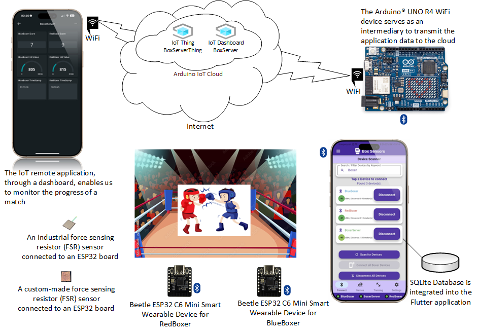
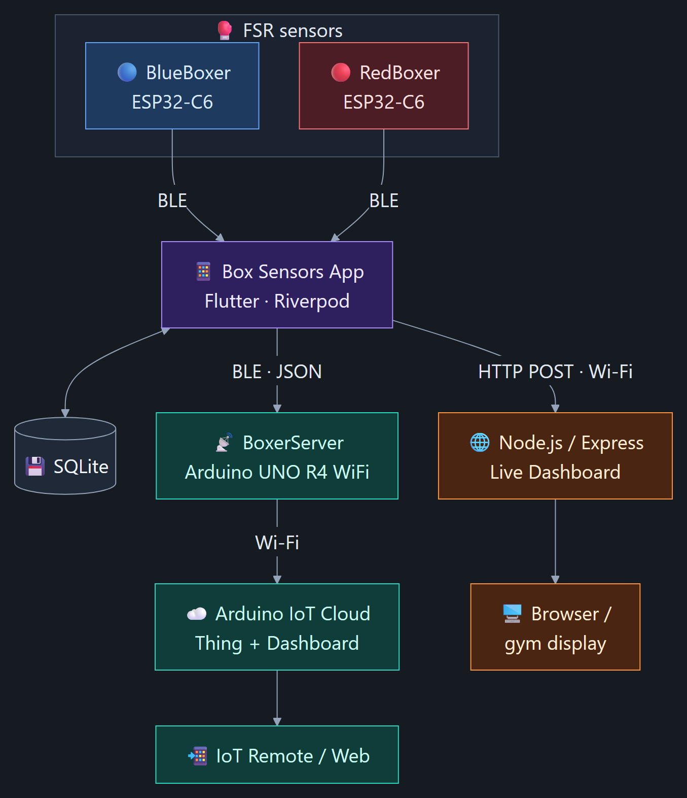
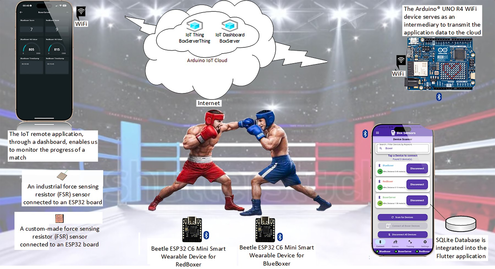
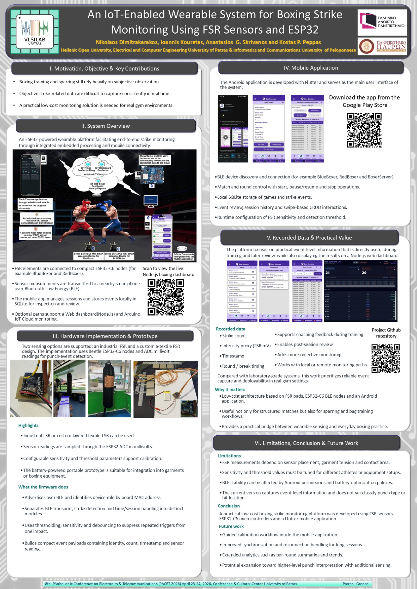
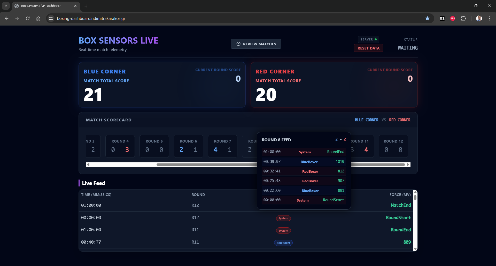
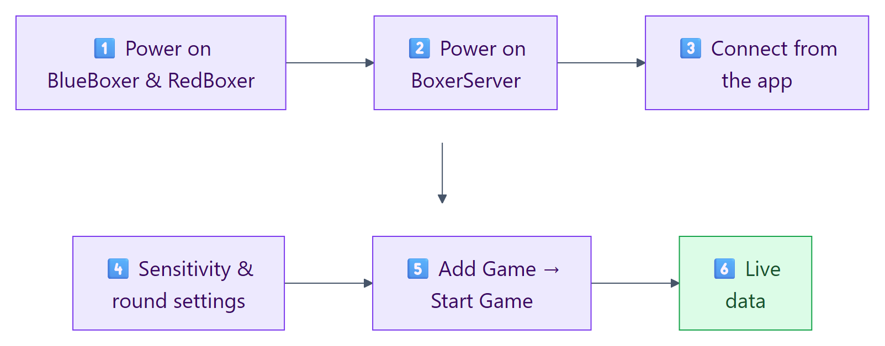

[](./README.md)
[](./README.en.md) &nbsp; [🇬🇷 Ελληνικά](./README.md) | [🇬🇧 English](./README.en.md)

<a id="top"></a>

<div align="center">


# 🥊 Box Sensors

### Development of a System in the Field of Sports Boxing for Monitoring Punch Intensity and Count During a Match

*Wearable FSR sensors · ESP32-C6 nodes over Bluetooth Low Energy · Flutter Android app · Arduino IoT Cloud · Live Web Dashboard*

<br>

<a href="https://github.com/sanguinarypc/BoxingGymSensorsProject"></a>
<a href="https://flutter.dev/"></a>
<a href="https://dart.dev/"></a>
<a href="https://developer.android.com/"></a>
<br>
<a href="https://wiki.dfrobot.com/SKU_DFR1117_Beetle_ESP32_C6"></a>
<a href="https://docs.arduino.cc/hardware/uno-r4-wifi/"></a>
<a href="https://ieeexplore.ieee.org/document/11498282"></a>
<a href="https://doi.org/10.1109/PACET68758.2026.11498282"></a>
<br>
<a href="https://play.google.com/store/apps/details?id=com.sanguinarypc.box_sensors"></a>
<a href="https://boxing-dashboard.ndimitrakarakos.gr/"></a>
<a href="https://www.youtube.com/@ΝΙΚΟΛΑΟΣ_ΔΗΜΗΤΡΑΚΑΡΑΚΟΣ"></a>
<a href="https://apothesis.eap.gr/archive/item/222407"></a>

<br>

**[📰 IEEE Paper](#paper)** &nbsp;·&nbsp; **[🏗️ Architecture](#architecture)** &nbsp;·&nbsp; **[📱 App](#android-app)** &nbsp;·&nbsp; **[🔌 ESP32](#esp32)** &nbsp;·&nbsp; **[☁️ Arduino Cloud](#arduino)** &nbsp;·&nbsp; **[🛠️ Setup](#how-to-use)**

</div>

---

<details>
<summary><b>📑 Table of Contents</b></summary>

<br>

- [📝 Project Description](#description)
  - [🏗️ System Architecture](#architecture)
- [📰 Scientific Publication — IEEE PACET 2026](#paper)
- [🎓 Practical Training in Software Topics](#practice)
- [📄 Thesis Document](#thesis)
- [🤝 Contributing](#contributing)
- [📱 Android Application — Box Sensors App](#android-app)
- [🔧 Technologies Used](#technologies)
- [📦 Dependencies — Modules](#dependencies)
- [🔌 Code for ESP32 Beetle C6 (FSR Sensors)](#esp32)
- [☁️ Code for Arduino Uno R4 WiFi](#arduino)
- [📺 Videos & Live Dashboard](#youtube)
- [🛠️ How to Use the Code](#how-to-use)
- [🚀 Run in Debug Mode](#run-debug)
- [🔄 Package Upgrades & Code Checks](#run-upgrade)
- [🚀 Run in Release Mode](#run-release)
- [🗂️ Folder Structure](#structure)

</details>

---

<a id="description"></a>

## 📝 Project Description

This repository contains the code for the undergraduate thesis titled **"Development of a System in the Field of Sports Boxing for Monitoring Punch Intensity and Count During a Match"**. The system was also presented as a scientific paper at the **IEEE PACET 2026** conference ([see below](#paper)).

The project consists of three main parts:

| # | Subsystem | Role |
|:-:|---|---|
| 1 | 📱 **Android Application (Flutter & Dart)** | The central control unit: connects to the sensors over BLE, manages matches and rounds, stores punches in SQLite and displays the data in real time. |
| 2 | 🔌 **Code for Microcontroller ESP32 Beetle C6** | Runs on the ESP32, which is connected to FSR (Force Sensitive Resistor) sensors to detect punches. |
| 3 | ☁️ **Code for Arduino Uno R4 WiFi** | Receives JSON data via Bluetooth from the Android application and uploads them to Arduino Cloud over Wi-Fi. |

> 🌐 Optionally, the app also sends the events over HTTP to a **Node.js Web Server** for [live match monitoring](https://boxing-dashboard.ndimitrakarakos.gr/) from any browser.



<a id="architecture"></a>

### 🏗️ System Architecture

<p align="center">
  
</p>

<p align="right"><a href="#top">⬆️ Back to top</a></p>

---

<a id="paper"></a>

## 📰 Scientific Publication — IEEE PACET 2026

<div align="center">

<a href="https://ieeexplore.ieee.org/document/11498282"></a>
<a href="https://doi.org/10.1109/PACET68758.2026.11498282"></a>
<a href="https://sites.google.com/g.upatras.gr/pacet2026"></a>

</div>

> ### An IoT-Enabled Wearable System for Boxing Strike Monitoring Using FSR Sensors and ESP32
> **Nikolaos Dimitrakarakos, Ioannis Kouretas, Anastasios G. Skrivanos, Kostas P. Peppas**
>
> *2026 Panhellenic Conference on Electronics & Telecommunications (PACET)*, Patras, Greece, April 23–24, 2026, pp. 1–4, IEEE.
> DOI: [10.1109/PACET68758.2026.11498282](https://doi.org/10.1109/PACET68758.2026.11498282)

| | |
|---|---|
| 🏛️ **Conference** | [8th Panhellenic Conference on Electronics & Telecommunications (PACET 2026)](https://sites.google.com/g.upatras.gr/pacet2026) |
| 📍 **Venue** | Conference & Cultural Center, University of Patras |
| 🗓️ **Presentation** | Poster Session P1 · ID 35 · April 23, 2026 — [📋 Conference program](https://sites.google.com/g.upatras.gr/pacet2026/program) |
| 🎓 **Institutions** | Hellenic Open University · University of Patras · University of Peloponnese |
| 📚 **Publication** | Conference proceedings in the IEEE Xplore Digital Library |

**In short.** The paper presents the system in this repository as a complete, low-cost platform for recording boxing strikes, designed for real gym conditions:

- 🧵 **Sensors** — industrial FSR sensors or custom-made e-textile sensors, integrated into a boxing vest or a punching bag.
- ⚡ **Embedded system** — Beetle ESP32-C6 nodes measure the signal in millivolts via the ADC, detect strikes with configurable sensitivity, threshold and debouncing, and send them over Bluetooth Low Energy.
- 📱 **Application** — the Flutter app manages matches and rounds, stores events in SQLite and optionally forwards them to Arduino IoT Cloud and to a Node.js dashboard.
- 🔬 **Evaluation** — comparison with related combat-sports sensing systems, practical limitations and next steps (guided calibration, more robust reconnection, per-round analytics).

**Keywords:** `ESP32` · `FSR` · `mobile application` · `e-textiles` · `smart textiles` · `combat sports` · `boxing` · `strike detection`

<p align="center">
  <a href="pictures/InformationSystem.png"></a>
  <br>
  <sub><i>Overview of the information system, as presented in the paper. © 2026 IEEE. Click for full resolution.</i></sub>
</p>

#### 🖼️ The conference poster

<table>
  <tr>
    <td width="250" align="center" valign="top">
      <a href="pictures/Pcet2026_Poster.jpg"></a>
      <br>
      <sub>🔍 Click to enlarge</sub>
    </td>
    <td valign="top">
      The work was presented as a poster at <b>PACET 2026</b>, at the University of Patras. The poster covers:
      <br><br>
      <b>I.</b> Motivation, objective and key contributions<br>
      <b>II.</b> System overview<br>
      <b>III.</b> Hardware implementation and prototype<br>
      <b>IV.</b> Mobile application<br>
      <b>V.</b> Recorded data and practical value<br>
      <b>VI.</b> Limitations, conclusion and future work
      <br><br>
      The poster's QR codes link to Google Play, the Live Dashboard and this repository.
    </td>
  </tr>
</table>

#### 📌 How to cite this work

> N. Dimitrakarakos, I. Kouretas, A. G. Skrivanos and K. P. Peppas, "An IoT-Enabled Wearable System for Boxing Strike Monitoring Using FSR Sensors and ESP32," *2026 Panhellenic Conference on Electronics & Telecommunications (PACET)*, Patras, Greece, 2026, pp. 1–4, doi: 10.1109/PACET68758.2026.11498282.

<details>
<summary><b>BibTeX</b></summary>

```bibtex
@inproceedings{dimitrakarakos2026boxing,
  author    = {Dimitrakarakos, Nikolaos and Kouretas, Ioannis and Skrivanos, Anastasios G. and Peppas, Kostas P.},
  title     = {An IoT-Enabled Wearable System for Boxing Strike Monitoring Using FSR Sensors and ESP32},
  booktitle = {2026 Panhellenic Conference on Electronics \& Telecommunications (PACET)},
  address   = {Patras, Greece},
  year      = {2026},
  pages     = {1--4},
  publisher = {IEEE},
  doi       = {10.1109/PACET68758.2026.11498282}
}
```

</details>

> [!NOTE]
> The copyright of the paper belongs to IEEE. The full text is available through the [IEEE Xplore](https://ieeexplore.ieee.org/document/11498282) digital library.

<p align="right"><a href="#top">⬆️ Back to top</a></p>

---

<a id="practice"></a>

## 🎓 Practical Training in Software Topics

**TOPIC:** Development of a system in the field of sports boxing for monitoring punch intensity and count during a match.

[📄 2024_ΠΕ470 (PDF)](pictures/2024_ΠΕ470.pdf) [](pictures/2024_ΠΕ470.pdf)

<a id="thesis"></a>

## 📄 Thesis Document

| | |
|---|---|
| 👤 **Undergraduate thesis** | Nikolaos Dimitrakarakos · std083899@ac.eap.gr |
| 🇬🇷 **Greek title** | Ανάπτυξη συστήματος στο χώρο της αθλητικής πυγμαχίας για την παρακολούθηση της έντασης και πλήθους χτυπημάτων κατά τη διάρκεια αγώνα |
| 🇬🇧 **English title** | Development of a System for Monitoring Punch Intensity and Count During Boxing Matches |
| 🏛️ **H.O.U. Repository** | [](https://apothesis.eap.gr/archive/item/222407) <a href="https://apothesis.eap.gr/archive/item/222407" target="_blank" rel="noopener noreferrer">https://apothesis.eap.gr/archive/item/222407</a> |
| 📥 **Thesis PDF** | [📄 Plh40_Ptixiaki_N_Dimitrakarakos_PE470 (PDF)](pictures/Plh40_Ptixiaki_N_Dimitrakarakos_PE470.pdf) [](pictures/Plh40_Ptixiaki_N_Dimitrakarakos_PE470.pdf) |
| 👨‍🏫 **Supervising professor** | Ioannis Kouretas · kouretas@upatras.gr, kouretas.ioannis@ac.eap.gr |
| 📋 **Examination committee** | Evangelos Topalis, Konstantinos Giannakopoulos · topalis.evangelos@ac.eap.gr, giannakopoulos.konstantinos@ac.eap.gr |

The thesis is available in the Hellenic Open University (H.O.U.) repository and as a PDF in this GitHub repository.

<a id="contributing"></a>

## 🤝 Contributing

This project was developed as part of an undergraduate thesis. Contributions are not actively sought at this time.

<p align="right"><a href="#top">⬆️ Back to top</a></p>

---

<a id="android-app"></a>

## 📱 Android Application — Box Sensors App

The application was developed with **Flutter** and **Dart**, and allows the user to monitor, in real time, the punch data recorded by the sensors.

<p align="center">
  
  &nbsp;&nbsp;&nbsp;
  <a href="https://play.google.com/store/apps/details?id=com.sanguinarypc.box_sensors"></a>
</p>

<p align="center">
  • <strong>Google Play Store Link:</strong>
  <a href="https://play.google.com/store/apps/details?id=com.sanguinarypc.box_sensors">Box Sensors App</a>
</p>

**✨ Key features**

| | Feature |
|:-:|---|
| 📡 | BLE discovery and connection to the **BlueBoxer**, **RedBoxer** and **BoxerServer** devices |
| 🥊 | Create matches with rounds, round duration and break duration; start, pause/resume and stop |
| 💾 | Local storage of matches and punches in **SQLite**, even without Internet access |
| 📊 | Match history, per-round details and event list with swipe-based edit/delete |
| 🎚️ | Runtime configuration of FSR sensitivity and detection threshold |
| 🌐 | Live streaming of punches over HTTP to the Node.js Web Dashboard |
| 🎨 | Light and dark theme, Material Design 3 |
| 🛡️ | Error reporting with Sentry and guidance for Android battery optimization |

<a id="technologies"></a>

## 🔧 Technologies Used (Android App)

<p align="center">
  <a href="https://developer.android.com/studio"></a>
  <a href="https://code.visualstudio.com/"></a>
  <a href="https://flutter.dev/"></a>
  <a href="https://dart.dev/"></a>
</p>

**Development tools:**

* [Android Studio](https://developer.android.com/studio)
* [Flutter](https://flutter.dev/) — version **3.50.0** (stable) or newer
* [Dart](https://dart.dev/) — version **3.14.0** or newer
* [Visual Studio Code](https://code.visualstudio.com/)

<a id="dependencies"></a>

## 📦 Dependencies — Modules

**Technologies & Dependencies** — `box_sensors` app **v1.0.54+54** ([`pubspec.yaml`](./box_sensors/pubspec.yaml))

<p align="left">
  <a href="https://pub.dev/packages/flutter_riverpod"></a>
  <a href="https://pub.dev/packages/flutter_blue_plus"></a>
  <a href="https://pub.dev/packages/sqflite"></a>
  <a href="https://pub.dev/packages/sentry_flutter"></a>
  <a href="https://pub.dev/packages/flex_color_scheme"></a>
  <a href="https://pub.dev/packages/material_ui"></a>
  <a href="https://pub.dev/packages/http"></a>
  <a href="https://pub.dev/packages/permission_handler"></a>
  <a href="https://pub.dev/packages/audioplayers"></a>
  <a href="https://pub.dev/packages/file_picker"></a>
  <a href="https://pub.dev/packages/package_info_plus"></a>
  <a href="https://pub.dev/packages/flutter_slidable"></a>
</p>

These packages are used in the project (versions as in [`pubspec.yaml`](./box_sensors/pubspec.yaml) / `pubspec.lock`). Items marked 🆕 were added in recent releases.

<details open>
<summary><b>🧱 Core</b></summary>

| Package | Version | Use in the project |
|---|:-:|---|
| [async](https://pub.dev/packages/async) | `^2.13.1` | Utilities for streams and asynchronous code |
| [intl](https://pub.dev/packages/intl) | `^0.20.3` | Date, time and number formatting |
| [uuid](https://pub.dev/packages/uuid) | `^4.6.0` | Unique identifiers for matches and events |
| [sqflite](https://pub.dev/packages/sqflite) | `^2.4.6` | Local SQLite database |
| [shared_preferences](https://pub.dev/packages/shared_preferences) | `^2.5.6` | Persisting user settings |
| [path](https://pub.dev/packages/path) | `^1.9.1` | File path handling |
| [path_provider](https://pub.dev/packages/path_provider) | `^2.1.6` | Locating system folders (e.g. for the database) |
| 🆕 [path_provider_android](https://pub.dev/packages/path_provider_android) | `^2.3.1` | One consistent JNI implementation for Dart and Android builds |

</details>

<details open>
<summary><b>🔄 State management</b></summary>

| Package | Version | Use in the project |
|---|:-:|---|
| [flutter_riverpod](https://pub.dev/packages/flutter_riverpod) | `^3.5.0` | Riverpod 3 — providers for Bluetooth, database, theme and timer |

</details>

<details open>
<summary><b>📡 BLE · Permissions · Audio</b></summary>

| Package | Version | Use in the project |
|---|:-:|---|
| [flutter_blue_plus](https://pub.dev/packages/flutter_blue_plus) | `^2.3.15` | Bluetooth Low Energy: scanning, connecting, notifications |
| [permission_handler](https://pub.dev/packages/permission_handler) | `^13.0.2` | Bluetooth, location and battery permissions |
| 🆕 [permission_handler_android](https://pub.dev/packages/permission_handler_android) | `^14.1.1` | Explicitly pinned Android permissions implementation |
| [audioplayers](https://pub.dev/packages/audioplayers) | `^6.8.1` | Round timer tick sound |

</details>

<details open>
<summary><b>🎨 UI · Theming</b></summary>

| Package | Version | Use in the project |
|---|:-:|---|
| [flex_color_scheme](https://pub.dev/packages/flex_color_scheme) | `^9.0.0` | Material 3 themes, light and dark |
| 🆕 [material_ui](https://pub.dev/packages/material_ui) | `^1.11.1` | Material Design widgets used across all screens |
| [flutter_slidable](https://pub.dev/packages/flutter_slidable) | `^5.2.0` | Swipe actions (edit/delete) |
| [gap](https://pub.dev/packages/gap) | `^3.1.0` | Spacing between widgets |
| [animated_text_kit](https://pub.dev/packages/animated_text_kit) | `^4.3.0` | Animated text (e.g. in the About dialog) |

</details>

<details open>
<summary><b>🛠️ Platform · Tools</b></summary>

| Package | Version | Use in the project |
|---|:-:|---|
| [sentry_flutter](https://pub.dev/packages/sentry_flutter) | `^10.5.0` | Error reporting and performance monitoring |
| [package_info_plus](https://pub.dev/packages/package_info_plus) | `^10.2.2` | App version and package information |
| [file_picker](https://pub.dev/packages/file_picker) | `^13.4.0` | Picking files from the device (e.g. database import) |
| 🆕 [flutter_dotenv](https://pub.dev/packages/flutter_dotenv) | `^6.0.2` | Environment variables from a `.env` file |
| 🆕 [http](https://pub.dev/packages/http) | `^1.6.0` | Sending punches (JSON) to the Node.js Web Server |
| 🆕 [url_launcher](https://pub.dev/packages/url_launcher) | `^6.3.3` | Opening external links from the app |

</details>

<details>
<summary><b>🧪 Dev dependencies</b></summary>

| Package | Version | Use in the project |
|---|:-:|---|
| [flutter_test](https://api.flutter.dev/flutter/flutter_test/) | SDK | Tests |
| [logging](https://pub.dev/packages/logging) | `^1.3.0` | Logging messages |
| [flutter_launcher_icons](https://pub.dev/packages/flutter_launcher_icons) | `^0.14.4` | Generating app icons (including the adaptive icon) |
| 🆕 [flutter_lints](https://pub.dev/packages/flutter_lints) | `^6.0.0` | Static analysis lint rules |

</details>

> [!TIP]
> **What changed since the previous README:** major upgrades in Riverpod 2 → **3**, flutter_blue_plus 1 → **2**, sentry_flutter 8 → **10**, file_picker 10 → **13**, flex_color_scheme 8 → **9**, permission_handler 12 → **13**, package_info_plus 8 → **10** and flutter_slidable 4 → **5**. `material_color_utilities` is no longer a direct dependency.

<p align="right"><a href="#top">⬆️ Back to top</a></p>

---

<a id="esp32"></a>

## 🔌 Code for ESP32 Beetle C6 (FSR Sensors)

This firmware is designed for the **ESP32 Beetle C6** microcontroller. The ESP32 is responsible for reading data from the FSR sensors mounted on boxing equipment (bag, vests) and for processing and transmitting that data.

### ✨ Features

* Reading FSR sensor values via the ADC, directly in millivolts (`analogReadMilliVolts`).
* Processing data to detect valid punches, with configurable sensitivity, threshold and debouncing.
* Automatic role assignment (**BlueBoxer** / **RedBoxer**) based on the board's MAC address.
* Bluetooth Low Energy communication with the BoxSensors Android app, which forwards the data to the Arduino Uno R4 WiFi.

### 🛠️ Hardware

* Microcontroller ESP32 Beetle C6: [DFRobot Beetle ESP32 C6 Info](https://wiki.dfrobot.com/SKU_DFR1117_Beetle_ESP32_C6)
* FSR (Force Sensitive Resistor) sensors: [FSR 406 Datasheet](https://cdn.sparkfun.com/assets/c/4/6/8/b/2010-10-26-DataSheet-FSR406-Layout2.pdf)
* DIY FSR sensors: [Instructables — DIY Force Sensitive Resistor](https://www.instructables.com/DIY-Force-Sensitive-Resistor-FSR/)
* DIY FSR sensors: [Bela — DIY pressure sensor](https://learn.bela.io/tutorials/pure-data/sensors/diy-pressure-sensor/)
* Polymer Lithium Ion Battery — 3.7 V 800 mAh

### 📚 ESP32 Libraries

- **ESP32 Arduino Core** (`esp32` by Espressif Systems)
  Provides the runtime environment, GPIO, timers, communication peripherals, etc.
  [ESP32 Arduino Core GitHub Repository](https://github.com/espressif/arduino-esp32)

- **BLEDevice, BLEServer, BLEUtils, BLE2902** (part of the ESP32 Arduino Core for BLE)
  API for running the ESP32-C6 as a BLE server: services, characteristics, notifications, descriptors (BLE2902) and MTU.
  [BLE API Reference](https://docs.espressif.com/projects/arduino-esp32/en/latest/api-guides/ble.html)

- **ArduinoJson v7.4.1** (Benoit Blanchon)
  JSON (de)serialization for building and parsing commands over BLE.
  [ArduinoJson on GitHub](https://github.com/bblanchon/ArduinoJson)

- **Standard C++ Libraries** (`<vector>`, `<string.h>`, etc.)
  Basic data structures (std::vector, etc.) and C APIs.
  [cppreference.com headers](https://en.cppreference.com/w/cpp/header)

### 🧩 Custom Classes

| Class | Files | Role |
|---|---|---|
| **BoxingApp** | `BoxingApp.h` / `BoxingApp.cpp` | Central "orchestrator": init, command handling, synchronization of FSR, BLE and timeouts |
| **BluetoothHandler** | `BlueToothHandler.h` / `BluetoothHandler.cpp` | Wrapper for the BLE APIs: UART-style service/characteristics (RX/TX), notifications & writes |
| **FSRPunchDetector** | `FSRPunchDetector.h` / `FSRPunchDetector.cpp` | Debounce & threshold logic for valid punch detection from the FSR sensors |
| **TimeHandler** | `TimeHandler.h` / `TimeHandler.cpp` | Start/pause/reset of round timers with millisecond accuracy |
| **MacDevicesConfig** | `MacDevicesConfig.h` | Fixed MAC addresses → automatic name assignment ("BlueBoxer"/"RedBoxer") at startup |

<p align="right"><a href="#top">⬆️ Back to top</a></p>

---

<a id="arduino"></a>

## ☁️ Code for Arduino Uno R4 WiFi (Bluetooth to Arduino Cloud)

This firmware targets the **Arduino Uno R4 WiFi** platform. Its main purpose is to receive punch data (in JSON format) via Bluetooth Low Energy (BLE) and then forward it to Arduino Cloud using the board's Wi-Fi connectivity.

### ✨ Features

* Receive JSON data via Bluetooth.
* Connect to a Wi-Fi network.
* Send data to Arduino Cloud.

### 🛠️ Hardware

* Arduino Uno R4 WiFi: [Arduino Uno R4 WiFi Docs](https://docs.arduino.cc/hardware/uno-r4-wifi/)

### 📚 Arduino Uno R4 Wi-Fi Libraries

| Library | Role | Link |
|---|---|---|
| **Arduino Core for Uno R4 Wi-Fi** | Runtime environment for Renesas RA4M1: GPIO, UART, SPI, I²C, timers | [ArduinoCore-renesas](https://github.com/arduino/ArduinoCore-renesas) |
| **WiFi v1.9.1** | Network connection, TCP/IP stack | [Arduino WiFi library](https://github.com/arduino-libraries/WiFi) |
| **ArduinoIoTCloud v2.5.1** | Sync & auth of cloud variables, event handling | [Arduino IoT Cloud library](https://github.com/arduino-libraries/ArduinoIoTCloud) |
| **Arduino_ConnectionHandler** | Handles SSID/PASS from `arduino_secrets.h` for the Wi-Fi connection | [Official docs](https://docs.arduino.cc/libraries/arduino_connectionhandler/) |
| **ArduinoBLE v1.4.0** | BLE peripheral API for the UNO R4 Wi-Fi | [ArduinoBLE library](https://github.com/arduino-libraries/ArduinoBLE) |
| **ArduinoJson v7.4.1** | JSON (de)serialization for BLE messages ↔ Cloud variables | [ArduinoJson on GitHub](https://github.com/bblanchon/ArduinoJson) |
| **TimeLib v1.6.0** | Timestamp handling & formatting | [Time library](https://github.com/PaulStoffregen/Time) |

### 🧩 Custom Structures

| Structure | Role |
|---|---|
| **BluetoothHandler** (`BluetoothHandler.h` / `BluetoothHandler.cpp`) | BLE wrapper for ArduinoBLE, server setup & message handling |
| **JsonHandler** (inside the `.ino`) | Static `parseIncoming()` for JSON → Cloud variables |
| **thingProperties.h** | Auto-generated by IoT Cloud: defines the cloud variables |
| **arduino_secrets.h** | Holds the Wi-Fi credentials (SSID & PASS) — empty in the repo, fill in your own |

<p align="right"><a href="#top">⬆️ Back to top</a></p>

---

<a id="youtube"></a>

## 📺 Check the YouTube Channel

[](https://www.youtube.com/@ΝΙΚΟΛΑΟΣ_ΔΗΜΗΤΡΑΚΑΡΑΚΟΣ)

<table>
  <tr>
    <td width="50%" valign="top">
      <b>🎬 Tutorial Video. The information system.</b><br>
      <sub>How the three parts of the project interact.</sub><br><br>
      <a href="https://www.youtube.com/watch?v=TOi7IgSo4TA&t=1583s"></a><br>
      <sub><i>Watch the video about the information system I built for my thesis.</i></sub>
    </td>
    <td width="50%" valign="top">
      <b>🎬 Tutorial Video. BoxSensors Application.</b><br>
      <sub>How to use the app.</sub><br><br>
      <a href="https://www.youtube.com/watch?v=eGz2vPkHj8w&t=21s"></a><br>
      <sub><i>Watch the video about the BoxSensors app for Android devices that I built for my thesis.</i></sub>
    </td>
  </tr>
</table>

### 🌐 Real-Time Web Dashboard (Node.js Web Server)



*Box Sensors Live Dashboard — live match telemetry and scores from the boxing sensor system.*

**Live Dashboard:** https://boxing-dashboard.ndimitrakarakos.gr/
*Server-hosted web dashboard for real-time match monitoring (scores, rounds and event feed). The app sends each punch (device, timestamp, punch count, intensity) as JSON via HTTP POST, while also storing it in the local SQLite database.*

<p align="right"><a href="#top">⬆️ Back to top</a></p>

---

<a id="how-to-use"></a>

## 🛠️ How to Use the Code

This section provides instructions for installing and running the software for the boxing punch-monitoring system. The system consists of three main subsystems: the ESP32 Beetle C6 microcontroller for punch detection, the Arduino IoT Cloud platform for data visualization via an Arduino Uno R4 Wi-Fi, and a Flutter app (Box Sensors) for control and data collection.

### 1️⃣ ESP32 Beetle C6 Setup (BlueBoxer & RedBoxer)

_The ESP32 Beetle C6 microcontrollers are responsible for collecting data from the FSR sensors that detect punches. Their code is written in C/C++._

**Required Tools:**
- Arduino IDE
- USB Type-C cable

**Installation Steps:**

1. **Install ESP32 support in the Arduino IDE**
   - Open the Arduino IDE → File > Preferences
   - In "Additional Boards Manager URLs" add
     `https://raw.githubusercontent.com/espressif/arduino-esp32/gh-pages/package_esp32_index.json`
   - Tools > Board > Boards Manager… → search "esp32" → install "esp32 by Espressif Systems"
   - Tools > Board > ESP32 Arduino → select "DFRobot Beetle ESP32-C6" or similar

2. **Upload the Code**
   - Open the repo's [`ESP32_Beetle_C6_FSR`](./ESP32_Beetle_C6_FSR/) folder → click `ESP32_Beetle_C6_FSR.ino` to view or download it.
   - (alternatively) Clone the repo:
     ```bash
     git clone https://github.com/sanguinarypc/BoxingGymSensorsProject.git
     cd BoxingGymSensorsProject/ESP32_Beetle_C6_FSR
     ```
   - You will see the classes `BoxingApp`, `FSRPunchDetector`, `TimeHandler`, `BluetoothHandler`.
   - Open `ESP32_Beetle_C6_FSR.ino` in the Arduino IDE, connect the ESP32 Beetle C6 via USB, select the correct COM port and press **Upload**.

**Hardware Setup:**
- Connect the FSR sensors to the designated analog inputs of the ESP32-C6 (e.g. GPIO 6, etc.)
- Power it with a Li-Po 3.7 V 800 mAh battery or another stable source

### 2️⃣ Arduino IoT Cloud Setup (BoxerServer)

_The Uno R4 Wi-Fi acts as an intermediate node: it receives BLE data from the Flutter app and sends it to the Cloud over Wi-Fi._

**Required Tools:**
- Arduino IoT Cloud account
- Arduino Uno R4 Wi-Fi
- USB cable

**Installation Steps:**

1. **Create a Thing**
   - Log in to Arduino IoT Cloud → New Thing
   - Define Cloud Variables (e.g. `deviceThatGotHit`, `punchScore`, `blueBoxer_punchCount`)
   - Link the Uno R4 Wi-Fi to the Thing
2. **Configure Wi-Fi**
   - In the Thing settings: enter the SSID & password (stored in `arduino_secrets.h`)
3. **Upload the Code**
   - In the Thing's **Sketch** tab: open/edit the `.ino` (Appendix A)
   - Compile & Upload
4. **Create a Dashboard**
   - In the Cloud: New Dashboard → add widgets and bind them to the Cloud Variables
   - Monitor on the Web or through the "IoT Remote" mobile app

**Hardware Setup:**
- Power it with a power bank that has a USB Type-C cable

### 3️⃣ Flutter Application Setup (Box Sensors)

_The Android app (Flutter/Dart) is the central control and data-collection unit._

**Required Tools:**
- Android Studio or VS Code
- Flutter SDK **≥ 3.50.0** & Dart SDK **≥ 3.14.0**
- Android device (e.g. Honor10Lite with Android 10)

**Installation Steps:**
1. Install the Flutter SDK (from https://flutter.dev)
2. Open the [`box_sensors`](./box_sensors/) folder in your IDE
3. `flutter pub get` for the dependencies (e.g. `flutter_riverpod`, `flutter_blue_plus`, `sqflite`, etc.)
4. Connect an Android device (`flutter devices`)
5. `flutter run`

**App Permissions:**
- Location (BLE scanning): "Allow only while using the app"
- Ignore Battery Optimizations: "Allow"
- Bluetooth: required for the ESP32 boards & the Uno R4 Wi-Fi

### ▶️ System Run Procedure

<p align="center">
  
</p>

1. Power on "BlueBoxer" & "RedBoxer" (ESP32-C6) → they start advertising over BLE
2. Power on "BoxerServer" (Uno R4 Wi-Fi) → it connects to Wi-Fi & IoT Cloud and advertises over BLE
3. Open the "Box Sensors" app on the phone → connect to the three devices
4. Configure sensitivities, rounds and durations in "Settings"
5. Create & start a match ("Add Game" → "Start Game")
6. Watch the live data: ESP32 → App → Uno R4 Wi-Fi → Cloud Dashboard (and, optionally, App → Node.js Live Dashboard)

_For the source code of each subsystem, simply navigate to the corresponding directories of this repo:_

- **ESP32 Beetle C6 FSR firmware**: [`ESP32_Beetle_C6_FSR/`](./ESP32_Beetle_C6_FSR/)
- **Arduino IoT Cloud (Uno R4 Wi-Fi)**: [`BoxServerThing/`](./BoxServerThing/)
- **Flutter Android app (Box Sensors)**: [`box_sensors/`](./box_sensors/)

> [!IMPORTANT]
> Before proceeding, make sure you have installed all the packages and libraries mentioned in this document. All the commands below run **inside the `box_sensors/` folder** (Bash or PowerShell). More detailed notes are in [`box_sensors/commands_en.md`](./box_sensors/commands_en.md).

**🧭 Which command for which goal**

| I want to… | Command | Output |
|---|---|---|
| Run the app during development | `flutter run` | Debug build on the connected phone, with hot reload |
| Check real-world speed | `flutter run --release` | Release build on the phone, no distributable file |
| Install the app **directly** on a phone | `flutter build apk --release` → `flutter install` | An **`.apk`** file installed over USB |
| Publish a new version on **Google Play** | `flutter build appbundle --release` | An **`.aab`** file for the Google Play Console |

<a id="run-debug"></a>

## 🚀 Run in Debug Mode

**Phase A — Development.** Below are the basic commands to build, run and debug the Flutter app, in the order they are executed:

### 0. Check the environment (optional)
```powershell
flutter doctor -v
```
Checks that the Flutter SDK, Android SDK/toolchain, Java and devices are set up correctly. Useful the first time, when something won't build, or after upgrading Flutter.

### 1. Clean previous builds
```powershell
flutter clean
```
Deletes the `build/` and `.dart_tool/` folders so no stale pieces from a previous build remain.

### 2. Install (or update) dependencies
```powershell
flutter pub get
```
Downloads the packages exactly as listed in `pubspec.lock`. It upgrades nothing.

### 3. Check the connected device
```powershell
flutter devices
```
Shows whether Flutter "sees" the phone (USB, developer mode and USB debugging enabled) or an emulator.

### 4. Run in debug mode (debug is the default) — equivalent to `flutter run --debug`
```powershell
flutter run
```
Builds and runs the app on the device. While it runs: `r` = hot reload, `R` = hot restart, `q` = quit.

<a id="run-upgrade"></a>

## 🔄 Package Upgrades & Code Checks

**Phase B — Upgrades (when needed).** Not required for every build; done when we want newer package versions.

### 1. Check for newer versions
```powershell
flutter pub outdated
```
Shows, for each package, the current version (**Current**), the version allowed without editing `pubspec.yaml` (**Upgradable**) and the newest one (**Latest**). It changes nothing.

### 2. Upgrade packages (pick **one** of the two)
```powershell
flutter pub upgrade --tighten
```
**Recommended:** upgrades within the `^` constraints and also writes the new versions into `pubspec.yaml`, so the YAML shows what is actually in use.
```powershell
flutter pub upgrade
```
Alternatively: the same upgrade, but it changes **only** `pubspec.lock`.

> Neither performs a **major** upgrade (e.g. 13.x → 14.x). That is done with `flutter pub upgrade --major-versions` or by hand, and it may require code changes.

### 3. Review what changed
```powershell
git diff pubspec.yaml
flutter pub deps --style=compact
```
`git diff` shows line by line what changed in `pubspec.yaml`. `flutter pub deps` (optional) shows which package pulls in which, useful when a package won't upgrade.

**Phase C — Code checks (before every release).**

### 4. Static analysis
```powershell
flutter analyze
```
Finds errors, warnings and deprecated APIs. It should report `No issues found!` before you continue.

### 5. Tests
```powershell
flutter test
```
Runs the tests in the `test/` folder. Fix any failure before building.

<a id="run-release"></a>

## 🚀 Run in Release Mode

**Phase D — Release.** Below are the commands to build, run and release the Flutter app, in the order they are executed:

### 1. Bump the version (only if releasing)
In `pubspec.yaml`, edit the `version` line by hand:
```yaml
version: 1.0.54+54   →   version: 1.0.55+55
```
`1.0.55` is the `versionName` users see. `+55` is the `versionCode`, which **must increase** with every Google Play upload.

### 2. Clean previous builds
```powershell
flutter clean
```

### 3. Install (or update) dependencies
```powershell
flutter pub get
```

### 4. Test in release mode on the phone
```powershell
flutter run --release
```
Builds and runs the app as users will see it (faster, no debugging). Test the BLE sensor connection, file picking, and that errors reach Sentry.

### 5a. Path A — APK for direct installation on a phone

**Create a release APK**
```powershell
flutter build apk --release
```
Builds `build\app\outputs\flutter-apk\app-release.apk`, which installs directly on a phone without Google Play.

**Install the APK on the phone**

Requires the phone to be connected to a USB port of the computer and to be in developer mode.
```powershell
flutter install
```

### 5b. Path B — App Bundle (AAB) for the Google Play Store
```powershell
flutter build appbundle --release
```
Builds `build\app\outputs\bundle\release\app-release.aab`. This file is uploaded to the **Google Play Console** (Release → Testing or Production) to reach the Google Play Store. An `.aab` **cannot** be installed directly on a phone.

**Or everything at once with the project script:**
```powershell
.\full_release_build.ps1
```
Runs in order: stop Gradle daemons → `gradlew clean` → `flutter clean` → `flutter pub get` → `flutter pub upgrade` → `flutter pub outdated` → `flutter analyze` → `flutter build appbundle --release`.

> [!WARNING]
> The script also runs `flutter pub upgrade`, so it **may change `pubspec.lock`**. Check with `git diff` before committing. Both paths need the signing key (`android/key.properties` + keystore), which is **not** uploaded to GitHub.

### 6. Commit the changes
```powershell
git add pubspec.yaml pubspec.lock
git commit -m "chore(release): 1.0.55+55"
```
Saves the version changes to git. Adjust the message to what was done (package upgrades, new version, etc.).

<details>
<summary><b>📋 All commands in order (copy-paste)</b></summary>

<br>

```powershell
# Phase A — Debug (development)
flutter doctor -v
flutter clean
flutter pub get
flutter devices
flutter run

# Phase B — Package upgrades (when needed)
flutter pub outdated
flutter pub upgrade --tighten
git diff pubspec.yaml

# Phase C — Code checks
flutter analyze
flutter test

# Phase D — Release (bump the version in pubspec.yaml first)
flutter clean
flutter pub get
flutter run --release
flutter build apk --release        # Path A: APK for direct installation
flutter install
flutter build appbundle --release  # Path B: AAB for the Google Play Console
git add pubspec.yaml pubspec.lock
git commit -m "chore(release): 1.0.55+55"
```

</details>

<p align="right"><a href="#top">⬆️ Back to top</a></p>

---

<a id="structure"></a>

## 🗂️ Folder Structure

**Simple Structure:**
```text
.
├── box_sensors/          # Flutter app code
├── ESP32_Beetle_C6_FSR/  # ESP32 code
├── BoxServerThing/       # Arduino Uno R4 WiFi code (IoT Cloud)
├── pictures/             # Images, poster and thesis documents (PDF)
├── README.md             # Ελληνικά
└── README.en.md          # English
```

Links:
- 📁 [box_sensors](./box_sensors/)
- 📁 [ESP32_Beetle_C6_FSR](./ESP32_Beetle_C6_FSR/)
- 📁 [BoxServerThing](./BoxServerThing/)
- 📁 [pictures](./pictures/)
- 📄 [README.md](./README.md) · [README.en.md](./README.en.md)

<details>
<summary><b>🔎 Detailed Structure</b></summary>

<br>

```text
.
├── box_sensors/                  # Flutter app (Android)
│   ├── lib/
│   │   ├── main.dart             # Entry point (Sentry, Riverpod, theme)
│   │   ├── models/               # Data models (e.g. sensor_data.dart)
│   │   ├── screens/              # App screens (matches, rounds, device connection)
│   │   ├── screens_widgets/      # Reusable widgets for the screens
│   │   ├── services/             # Bluetooth, SQLite, database import, HTTP sending, Riverpod providers
│   │   ├── state/                # Timer controller
│   │   ├── Themes/               # Themes, Material Design (screen colors), edge-to-edge
│   │   ├── utils/                # BLE permissions, device config, orientation, system UI
│   │   └── widgets/              # Reusable widgets (settings, web server, navbar, etc.)
│   ├── assets/                   # Images, icons and sounds
│   ├── pubspec.yaml
│   └── README.md                 # README specific to the Flutter module
│
├── ESP32_Beetle_C6_FSR/          # ESP32 Beetle C6 + FSR (Arduino IDE)
│   ├── ESP32_Beetle_C6_FSR.ino   # Main ESP32 sketch (entry point) — older name: EBoxingGymSensors
│   ├── BoxingApp.h               # Main firmware class (orchestrator)
│   ├── BoxingApp.cpp             # Commands, FSR/BLE/time synchronization, timeouts
│   ├── BlueToothHandler.h        # BLE server interface (UART-style RX/TX)
│   ├── BluetoothHandler.cpp      # BLE implementation (notifications & writes)
│   ├── FSRPunchDetector.h        # FSR sensor "punch" detection API
│   ├── FSRPunchDetector.cpp      # Punch detection logic & debounce
│   ├── TimeHandler.h             # Timestamp & elapsed-time utility
│   ├── TimeHandler.cpp           # Time management implementation
│   ├── MacDevicesConfig.h        # Predefined MAC addresses for BlueBoxer / RedBoxer
│   ├── EBoxingGymSensors.txt     # Sample CSV/JSON for data importer
│   └── pin_configuration_n.png   # Wiring diagram (FSR → GPIO pins)
│
├── BoxServerThing/               # Arduino UNO R4 WiFi (IoT Cloud)
│   ├── BoxServerThing.ino        # Main sketch (.ino = Thing name)
│   ├── thingProperties.h         # Generated by IoT Cloud
│   ├── BluetoothHandler.h        # BLE interface
│   ├── BluetoothHandler.cpp      # BLE implementation
│   ├── arduino_secrets.h         # Wi-Fi credentials (empty in the repo)
│   ├── sketch.json               # Arduino Cloud sketch settings
│   └── ReadMe.adoc               # Additional documentation in AsciiDoc
│
├── pictures/                     # README images, PACET 2026 poster, thesis PDFs
├── README.md                     # Main README (Greek)
└── README.en.md                  # English version (this file)
```

</details>

<details>
<summary><b>🔗 Links (Detailed Structure)</b></summary>

### box_sensors
- 📁 [box_sensors](./box_sensors/)
- 📁 [box_sensors/lib](./box_sensors/lib/)
- 📄 [box_sensors/lib/main.dart](./box_sensors/lib/main.dart)
- 📁 [box_sensors/lib/models](./box_sensors/lib/models/)
- 📁 [box_sensors/lib/screens](./box_sensors/lib/screens/)
- 📁 [box_sensors/lib/screens_widgets](./box_sensors/lib/screens_widgets/)
- 📁 [box_sensors/lib/services](./box_sensors/lib/services/)
- 📁 [box_sensors/lib/state](./box_sensors/lib/state/)
- 📁 [box_sensors/lib/Themes](./box_sensors/lib/Themes/)
- 📁 [box_sensors/lib/utils](./box_sensors/lib/utils/)
- 📁 [box_sensors/lib/widgets](./box_sensors/lib/widgets/)
- 📁 [box_sensors/assets](./box_sensors/assets/)
- 📄 [box_sensors/pubspec.yaml](./box_sensors/pubspec.yaml)
- 📄 [box_sensors/README.md](./box_sensors/README.md)

### ESP32_Beetle_C6_FSR
- 📁 [ESP32_Beetle_C6_FSR](./ESP32_Beetle_C6_FSR/)
- 📄 [ESP32_Beetle_C6_FSR/ESP32_Beetle_C6_FSR.ino](./ESP32_Beetle_C6_FSR/ESP32_Beetle_C6_FSR.ino)
- 📄 [ESP32_Beetle_C6_FSR/BoxingApp.h](./ESP32_Beetle_C6_FSR/BoxingApp.h)
- 📄 [ESP32_Beetle_C6_FSR/BoxingApp.cpp](./ESP32_Beetle_C6_FSR/BoxingApp.cpp)
- 📄 [ESP32_Beetle_C6_FSR/BlueToothHandler.h](./ESP32_Beetle_C6_FSR/BlueToothHandler.h)
- 📄 [ESP32_Beetle_C6_FSR/BluetoothHandler.cpp](./ESP32_Beetle_C6_FSR/BluetoothHandler.cpp)
- 📄 [ESP32_Beetle_C6_FSR/FSRPunchDetector.h](./ESP32_Beetle_C6_FSR/FSRPunchDetector.h)
- 📄 [ESP32_Beetle_C6_FSR/FSRPunchDetector.cpp](./ESP32_Beetle_C6_FSR/FSRPunchDetector.cpp)
- 📄 [ESP32_Beetle_C6_FSR/TimeHandler.h](./ESP32_Beetle_C6_FSR/TimeHandler.h)
- 📄 [ESP32_Beetle_C6_FSR/TimeHandler.cpp](./ESP32_Beetle_C6_FSR/TimeHandler.cpp)
- 📄 [ESP32_Beetle_C6_FSR/MacDevicesConfig.h](./ESP32_Beetle_C6_FSR/MacDevicesConfig.h)
- 📄 [ESP32_Beetle_C6_FSR/EBoxingGymSensors.txt](./ESP32_Beetle_C6_FSR/EBoxingGymSensors.txt)
- 🖼️ [ESP32_Beetle_C6_FSR/pin_configuration_n.png](./ESP32_Beetle_C6_FSR/pin_configuration_n.png)

### BoxServerThing
- 📁 [BoxServerThing](./BoxServerThing/)
- 📄 [BoxServerThing/BoxServerThing.ino](./BoxServerThing/BoxServerThing.ino)
- 📄 [BoxServerThing/thingProperties.h](./BoxServerThing/thingProperties.h)
- 📄 [BoxServerThing/BluetoothHandler.h](./BoxServerThing/BluetoothHandler.h)
- 📄 [BoxServerThing/BluetoothHandler.cpp](./BoxServerThing/BluetoothHandler.cpp)
- 📄 [BoxServerThing/arduino_secrets.h](./BoxServerThing/arduino_secrets.h)
- 📄 [BoxServerThing/sketch.json](./BoxServerThing/sketch.json)
- 📄 [BoxServerThing/ReadMe.adoc](./BoxServerThing/ReadMe.adoc)

</details>

---

<div align="center">


**Box Sensors** · Undergraduate thesis at the Hellenic Open University · Published at IEEE PACET 2026

<sub>Nikolaos Dimitrakarakos · 🥊 Built for boxing, with sensors, ESP32 and Flutter</sub>

<a href="#top">⬆️ Back to top</a>

</div>
