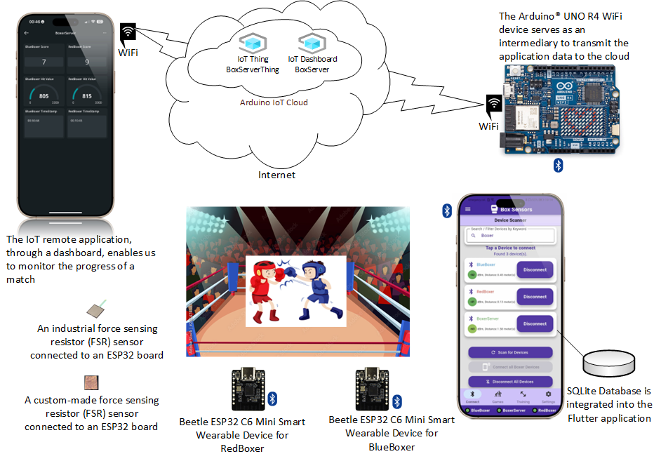
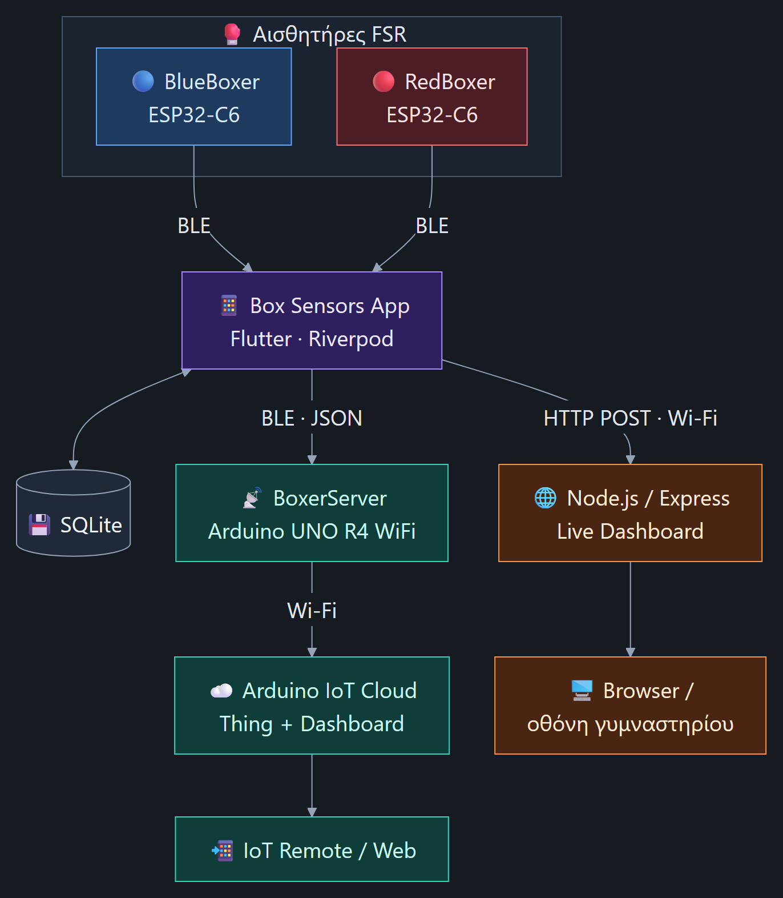
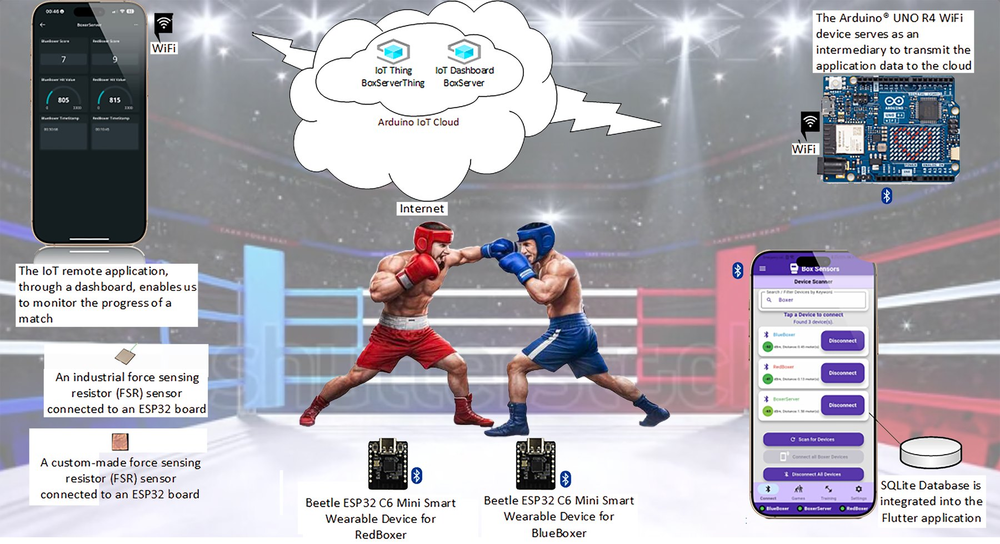
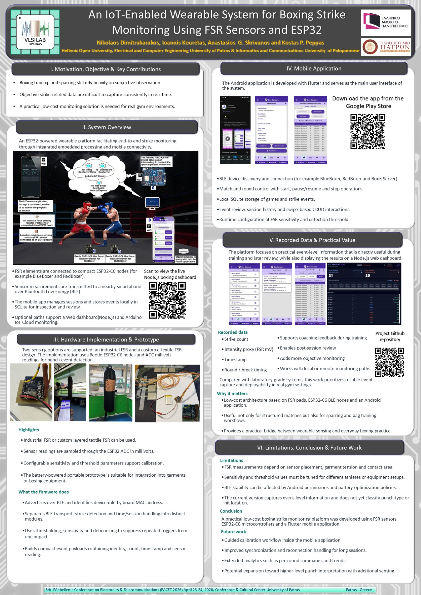
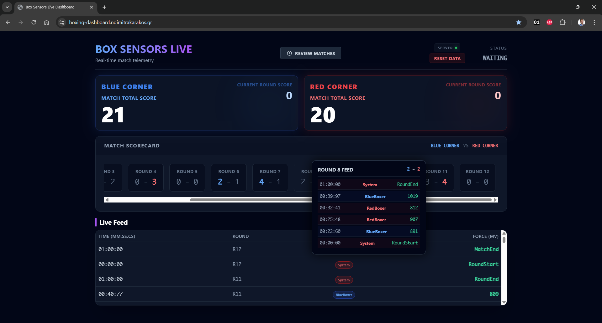
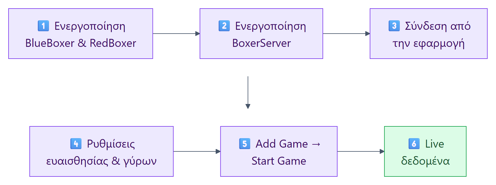

[](./README.md)
[](./README.en.md) &nbsp; [🇬🇷 Ελληνικά](./README.md) | [🇬🇧 English](./README.en.md) &nbsp;·&nbsp; 📕 **PDF:** [Ελληνικά](./README.pdf) | [English](./README.en.pdf)

<a id="top"></a>

<div align="center">


# 🥊 Box Sensors

### Ανάπτυξη συστήματος στο χώρο της αθλητικής πυγμαχίας για την παρακολούθηση της έντασης και πλήθους χτυπημάτων κατά τη διάρκεια αγώνα

*Φορητοί αισθητήρες FSR · Κόμβοι ESP32-C6 με Bluetooth Low Energy · Εφαρμογή Android σε Flutter · Arduino IoT Cloud · Live Web Dashboard*

<br>

<a href="https://github.com/sanguinarypc/BoxingGymSensorsProject"></a>
<a href="https://flutter.dev/"></a>
<a href="https://dart.dev/"></a>
<a href="https://developer.android.com/"></a>
<br>
<a href="https://wiki.dfrobot.com/SKU_DFR1117_Beetle_ESP32_C6"></a>
<a href="https://docs.arduino.cc/hardware/uno-r4-wifi/"></a>
<a href="https://ieeexplore.ieee.org/document/11498282"></a>
<a href="https://doi.org/10.1109/PACET68758.2026.11498282"></a>
<br>
<a href="https://play.google.com/store/apps/details?id=com.sanguinarypc.box_sensors"></a>
<a href="https://boxing-dashboard.ndimitrakarakos.gr/"></a>
<a href="https://www.youtube.com/@ΝΙΚΟΛΑΟΣ_ΔΗΜΗΤΡΑΚΑΡΑΚΟΣ"></a>
<a href="https://apothesis.eap.gr/archive/item/222407"></a>

<br>

<a href="https://boxing-dashboard.ndimitrakarakos.gr/"></a>
<br>
<sub>🌐 <a href="https://boxing-dashboard.ndimitrakarakos.gr/">boxing-dashboard.ndimitrakarakos.gr</a> — ζωντανό σκορ, γύροι και χτυπήματα από οποιονδήποτε browser</sub>

<br><br>

**[📰 Δημοσίευση IEEE](#paper)** &nbsp;·&nbsp; **[🏗️ Αρχιτεκτονική](#architecture)** &nbsp;·&nbsp; **[📱 Εφαρμογή](#android-app)** &nbsp;·&nbsp; **[🔌 ESP32](#esp32)** &nbsp;·&nbsp; **[☁️ Arduino Cloud](#arduino)** &nbsp;·&nbsp; **[🛠️ Εγκατάσταση](#how-to-use)**

</div>

---

<details>
<summary><b>📑 Πίνακας Περιεχομένων</b></summary>

<br>

- [📝 Περιγραφή Έργου](#description)
  - [🏗️ Αρχιτεκτονική Συστήματος](#architecture)
- [📰 Επιστημονική Δημοσίευση — IEEE PACET 2026](#paper)
- [🎓 Πρακτική Εξάσκηση σε θέματα Λογισμικού](#practice)
- [📄 Έγγραφο Πτυχιακής Εργασίας](#thesis)
- [🤝 Συνεισφορά](#contributing)
- [📱 Εφαρμογή Android — Box Sensors App](#android-app)
- [🔧 Τεχνολογίες που χρησιμοποιήθηκαν](#technologies)
- [📦 Dependencies — Modules](#dependencies)
- [🔌 Κώδικας για ESP32 Beetle C6 (FSR Sensors)](#esp32)
- [☁️ Κώδικας για Arduino Uno R4 WiFi](#arduino)
- [📺 Βίντεο & Live Dashboard](#youtube)
- [🛠️ Πώς να Χρησιμοποιήσετε τους Κώδικες](#how-to-use)
- [🚀 Εκτέλεση σε Debug mode](#run-debug)
- [🔄 Αναβάθμιση πακέτων & έλεγχος κώδικα](#run-upgrade)
- [🚀 Εκτέλεση σε Release Mode](#run-release)
- [🗂️ Δομή Φακέλων](#structure)

</details>

---

<a id="description"></a>

## 📝 Περιγραφή Έργου

Αυτό το αποθετήριο περιέχει τον κώδικα για την πτυχιακή εργασία με τίτλο **«Ανάπτυξη συστήματος στο χώρο της αθλητικής πυγμαχίας για την παρακολούθηση της έντασης και πλήθους χτυπημάτων κατά τη διάρκεια αγώνα»**. Το σύστημα παρουσιάστηκε επίσης ως επιστημονική εργασία στο συνέδριο **IEEE PACET 2026** ([δείτε παρακάτω](#paper)).

Το έργο αποτελείται από τρία κύρια μέρη:

| # | Υποσύστημα | Ρόλος |
|:-:|---|---|
| 1 | 📱 **Εφαρμογή Android (Flutter & Dart)** | Η κεντρική μονάδα ελέγχου: συνδέεται μέσω BLE με τους αισθητήρες, διαχειρίζεται αγώνες και γύρους, αποθηκεύει τα χτυπήματα σε SQLite και εμφανίζει τα δεδομένα σε πραγματικό χρόνο. |
| 2 | 🔌 **Κώδικας για Microcontroller ESP32 Beetle C6** | Τρέχει στον ESP32, ο οποίος είναι συνδεδεμένος με αισθητήρες FSR (Force Sensitive Resistors) για την ανίχνευση των χτυπημάτων. |
| 3 | ☁️ **Κώδικας για Arduino Uno R4 WiFi** | Λαμβάνει δεδομένα JSON μέσω Bluetooth από την εφαρμογή Android και τα ανεβάζει στο Arduino Cloud μέσω σύνδεσης WiFi. |

> 🌐 **Νεότερη προσθήκη:** η εφαρμογή στέλνει επίσης τα γεγονότα μέσω HTTP σε έναν **Web Server σε Node.js** για [ζωντανή παρακολούθηση του αγώνα](https://boxing-dashboard.ndimitrakarakos.gr/) από οποιονδήποτε browser.

**🕒 Εξέλιξη του έργου**

| Στάδιο | Τι περιλάμβανε |
|---|---|
| 🎓 **Πτυχιακή εργασία** · παρουσίαση 12 Ιουλίου 2025 | Αισθητήρες FSR + ESP32-C6, εφαρμογή Flutter, Arduino UNO R4 WiFi → Arduino IoT Cloud dashboard |
| 🌐 **Μετά την πτυχιακή** | Live Dashboard σε Node.js / Express, με πιο φιλική εμφάνιση για τους χρήστες |
| 📰 **IEEE PACET 2026** · 23 Απριλίου 2026 | Παρουσίαση του ολοκληρωμένου συστήματος, μαζί με το Node.js dashboard |

<p align="center">
  
  <br>
  <sub><i>Το πληροφοριακό σύστημα όπως σχεδιάστηκε στην πτυχιακή εργασία, με το Arduino IoT Cloud.</i></sub>
</p>

<a id="architecture"></a>

### 🏗️ Αρχιτεκτονική Συστήματος

<p align="center">
  
</p>

<p align="right"><a href="#top">⬆️ Επιστροφή στην αρχή</a></p>

---

<a id="paper"></a>

## 📰 Επιστημονική Δημοσίευση — IEEE PACET 2026

<div align="center">

<a href="https://ieeexplore.ieee.org/document/11498282"></a>
<a href="https://doi.org/10.1109/PACET68758.2026.11498282"></a>
<a href="https://sites.google.com/g.upatras.gr/pacet2026"></a>

</div>

> ### An IoT-Enabled Wearable System for Boxing Strike Monitoring Using FSR Sensors and ESP32
> **Nikolaos Dimitrakarakos, Ioannis Kouretas, Anastasios G. Skrivanos, Kostas P. Peppas**
>
> *2026 Panhellenic Conference on Electronics & Telecommunications (PACET)*, Πάτρα, 23–24 Απριλίου 2026, σσ. 1–4, IEEE.
> DOI: [10.1109/PACET68758.2026.11498282](https://doi.org/10.1109/PACET68758.2026.11498282)

| | |
|---|---|
| 🏛️ **Συνέδριο** | [8th Panhellenic Conference on Electronics & Telecommunications (PACET 2026)](https://sites.google.com/g.upatras.gr/pacet2026) |
| 📍 **Τόπος** | Συνεδριακό & Πολιτιστικό Κέντρο, Πανεπιστήμιο Πατρών |
| 🗓️ **Παρουσίαση** | Poster Session P1 · ID 35 · 23 Απριλίου 2026 — [📋 Πρόγραμμα του συνεδρίου](https://sites.google.com/g.upatras.gr/pacet2026/program) |
| 🎓 **Φορείς** | Ελληνικό Ανοικτό Πανεπιστήμιο · Πανεπιστήμιο Πατρών · Πανεπιστήμιο Πελοποννήσου |
| 📚 **Δημοσίευση** | Πρακτικά του συνεδρίου στην ψηφιακή βιβλιοθήκη IEEE Xplore |

**Με λίγα λόγια.** Το άρθρο παρουσιάζει το σύστημα αυτού του αποθετηρίου ως μια ολοκληρωμένη πλατφόρμα χαμηλού κόστους για την καταγραφή χτυπημάτων στην πυγμαχία, σχεδιασμένη για πραγματικές συνθήκες γυμναστηρίου:

- 🧵 **Αισθητήρες** — βιομηχανικοί αισθητήρες FSR ή χειροποίητοι αισθητήρες από αγώγιμα υφάσματα (e-textile), ενσωματωμένοι σε φανέλα ή σάκο.
- ⚡ **Ενσωματωμένο σύστημα** — κόμβοι Beetle ESP32-C6 μετρούν το σήμα σε millivolt μέσω ADC, ανιχνεύουν τα χτυπήματα με ρυθμιζόμενη ευαισθησία, κατώφλι και debounce, και τα στέλνουν μέσω Bluetooth Low Energy.
- 📱 **Εφαρμογή** — η εφαρμογή Flutter διαχειρίζεται αγώνες και γύρους, αποθηκεύει τα γεγονότα σε SQLite και τα προωθεί προαιρετικά στο Arduino IoT Cloud και σε Node.js dashboard.
- 🔬 **Αξιολόγηση** — σύγκριση με σχετικά συστήματα στα αθλήματα μάχης, πρακτικοί περιορισμοί και επόμενα βήματα (καθοδηγούμενη βαθμονόμηση, σταθερότερη επανασύνδεση, στατιστικά ανά γύρο).

**Λέξεις-κλειδιά:** `ESP32` · `FSR` · `mobile application` · `e-textiles` · `smart textiles` · `combat sports` · `boxing` · `strike detection`

<p align="center">
  <a href="pictures/InformationSystem.png"></a>
  <br>
  <sub><i>Επισκόπηση του πληροφοριακού συστήματος Box Sensors: αισθητήρες FSR, κόμβοι ESP32-C6, εφαρμογή Flutter με SQLite, Arduino UNO R4 WiFi και Arduino IoT Cloud. Κλικ για πλήρη ανάλυση.</i></sub>
</p>

#### 🖼️ Το poster του συνεδρίου

<table>
  <tr>
    <td width="250" align="center" valign="top">
      <a href="pictures/Pcet2026_Poster.jpg"></a>
      <br>
      <sub>🔍 Κλικ για μεγέθυνση</sub>
    </td>
    <td valign="top">
      Η εργασία παρουσιάστηκε σε μορφή poster στο <b>PACET 2026</b>, στο Πανεπιστήμιο Πατρών. Το poster συνοψίζει:
      <br><br>
      <b>I.</b> Κίνητρο, στόχος και βασικές συνεισφορές<br>
      <b>II.</b> Επισκόπηση του συστήματος<br>
      <b>III.</b> Υλικό και πρωτότυπο<br>
      <b>IV.</b> Εφαρμογή κινητού<br>
      <b>V.</b> Καταγεγραμμένα δεδομένα και πρακτική αξία<br>
      <b>VI.</b> Περιορισμοί, συμπεράσματα και μελλοντική εργασία
      <br><br>
      Τα QR codes του poster οδηγούν στο Google Play, στο Live Dashboard και σε αυτό το αποθετήριο.
    </td>
  </tr>
</table>

#### 📌 Πώς να αναφέρετε την εργασία

> N. Dimitrakarakos, I. Kouretas, A. G. Skrivanos and K. P. Peppas, "An IoT-Enabled Wearable System for Boxing Strike Monitoring Using FSR Sensors and ESP32," *2026 Panhellenic Conference on Electronics & Telecommunications (PACET)*, Patras, Greece, 2026, pp. 1–4, doi: 10.1109/PACET68758.2026.11498282.

<details>
<summary><b>BibTeX</b></summary>

```bibtex
@inproceedings{dimitrakarakos2026boxing,
  author    = {Dimitrakarakos, Nikolaos and Kouretas, Ioannis and Skrivanos, Anastasios G. and Peppas, Kostas P.},
  title     = {An IoT-Enabled Wearable System for Boxing Strike Monitoring Using FSR Sensors and ESP32},
  booktitle = {2026 Panhellenic Conference on Electronics \& Telecommunications (PACET)},
  address   = {Patras, Greece},
  year      = {2026},
  pages     = {1--4},
  publisher = {IEEE},
  doi       = {10.1109/PACET68758.2026.11498282}
}
```

</details>

> [!NOTE]
> Τα πνευματικά δικαιώματα του άρθρου ανήκουν στο IEEE. Το πλήρες κείμενο διατίθεται μέσω της ψηφιακής βιβλιοθήκης [IEEE Xplore](https://ieeexplore.ieee.org/document/11498282).

<p align="right"><a href="#top">⬆️ Επιστροφή στην αρχή</a></p>

---

<a id="practice"></a>

## 🎓 Πρακτική Εξάσκηση σε θέματα Λογισμικού

**ΘΕΜΑ:** Ανάπτυξη συστήματος στο χώρο της αθλητικής πυγμαχίας για την παρακολούθηση της έντασης και πλήθους χτυπημάτων κατά τη διάρκεια αγώνα.

[📄 2024_ΠΕ470 (PDF)](pictures/2024_ΠΕ470.pdf) [](pictures/2024_ΠΕ470.pdf)

<a id="thesis"></a>

## 📄 Έγγραφο Πτυχιακής Εργασίας

| | |
|---|---|
| 👤 **Πτυχιακή εργασία** | Νικόλαος Δημητρακαράκος · std083899@ac.eap.gr |
| 🇬🇷 **Τίτλος** | Ανάπτυξη συστήματος στο χώρο της αθλητικής πυγμαχίας για την παρακολούθηση της έντασης και πλήθους χτυπημάτων κατά τη διάρκεια αγώνα |
| 🇬🇧 **English title** | Development of a System for Monitoring Punch Intensity and Count During Boxing Matches |
| 🏛️ **Αποθετήριο Ε.Α.Π.** | [](https://apothesis.eap.gr/archive/item/222407) <a href="https://apothesis.eap.gr/archive/item/222407" target="_blank" rel="noopener noreferrer">https://apothesis.eap.gr/archive/item/222407</a> |
| 📥 **Έγγραφο πτυχιακής** | [📄 Plh40_Ptixiaki_N_Dimitrakarakos_PE470 (PDF)](pictures/Plh40_Ptixiaki_N_Dimitrakarakos_PE470.pdf) [](pictures/Plh40_Ptixiaki_N_Dimitrakarakos_PE470.pdf) |
| 👨‍🏫 **Επιβλέπων καθηγητής** | Ιωάννης Κουρέτας · kouretas@upatras.gr, kouretas.ioannis@ac.eap.gr |
| 📋 **Εξεταστική επιτροπή** | Τοπάλης Ευάγγελος, Γιαννακόπουλος Κωνσταντίνος · topalis.evangelos@ac.eap.gr, giannakopoulos.konstantinos@ac.eap.gr |

Η πτυχιακή βρίσκεται στο αποθετήριο του Ελληνικού Ανοικτού Πανεπιστημίου (Ε.Α.Π.) και ως PDF σε αυτό το αποθετήριο στο GitHub.

<a id="contributing"></a>

## 🤝 Συνεισφορά

Αυτό το έργο αναπτύχθηκε στο πλαίσιο πτυχιακής εργασίας. Προς το παρόν, δεν αναζητούνται ενεργά συνεισφορές.

<p align="right"><a href="#top">⬆️ Επιστροφή στην αρχή</a></p>

---

<a id="android-app"></a>

## 📱 Εφαρμογή Android — Box Sensors App

Η εφαρμογή αναπτύχθηκε με **Flutter** και **Dart**, και επιτρέπει στον χρήστη να παρακολουθεί σε πραγματικό χρόνο τα δεδομένα των χτυπημάτων που καταγράφουν οι αισθητήρες.

<p align="center">
  
  &nbsp;&nbsp;&nbsp;
  <a href="https://play.google.com/store/apps/details?id=com.sanguinarypc.box_sensors"></a>
</p>

<p align="center">
  • <strong>Google Play Store Link:</strong>
  <a href="https://play.google.com/store/apps/details?id=com.sanguinarypc.box_sensors">Box Sensors App</a>
</p>

**✨ Βασικές λειτουργίες**

| | Λειτουργία |
|:-:|---|
| 📡 | Αναζήτηση και σύνδεση μέσω BLE με τις συσκευές **BlueBoxer**, **RedBoxer** και **BoxerServer** |
| 🥊 | Δημιουργία αγώνων με γύρους, διάρκεια γύρου και διαλείμματος· έναρξη, παύση/συνέχεια και τερματισμός |
| 💾 | Τοπική αποθήκευση αγώνων και χτυπημάτων σε **SQLite**, ακόμη και χωρίς σύνδεση στο Internet |
| 📊 | Ιστορικό αγώνων, λεπτομέρειες ανά γύρο και λίστα γεγονότων με επεξεργασία/διαγραφή με swipe |
| 🎚️ | Ρύθμιση της ευαισθησίας και του κατωφλίου ανίχνευσης των FSR την ώρα της χρήσης |
| 🌐 | Ζωντανή αποστολή των χτυπημάτων μέσω HTTP στο Node.js Web Dashboard |
| 🎨 | Φωτεινό και σκοτεινό θέμα, Material Design 3 |
| 🛡️ | Αναφορά σφαλμάτων με Sentry και οδηγίες για τη βελτιστοποίηση μπαταρίας του Android |

<a id="technologies"></a>

## 🔧 Τεχνολογίες που χρησιμοποιήθηκαν (Android App)

<p align="center">
  <a href="https://developer.android.com/studio"></a>
  <a href="https://code.visualstudio.com/"></a>
  <a href="https://flutter.dev/"></a>
  <a href="https://dart.dev/"></a>
</p>

**Εργαλεία ανάπτυξης:**

* [Android Studio](https://developer.android.com/studio)
* [Flutter](https://flutter.dev/) — έκδοση **3.50.0** (stable) ή νεότερη
* [Dart](https://dart.dev/) — έκδοση **3.14.0** ή νεότερη
* [Visual Studio Code](https://code.visualstudio.com/)

<a id="dependencies"></a>

## 📦 Dependencies — Modules

**Τεχνολογίες & Dependencies** — εφαρμογή `box_sensors` **v1.0.54+54** ([`pubspec.yaml`](./box_sensors/pubspec.yaml))

<p align="left">
  <a href="https://pub.dev/packages/flutter_riverpod"></a>
  <a href="https://pub.dev/packages/flutter_blue_plus"></a>
  <a href="https://pub.dev/packages/sqflite"></a>
  <a href="https://pub.dev/packages/sentry_flutter"></a>
  <a href="https://pub.dev/packages/flex_color_scheme"></a>
  <a href="https://pub.dev/packages/material_ui"></a>
  <a href="https://pub.dev/packages/http"></a>
  <a href="https://pub.dev/packages/permission_handler"></a>
  <a href="https://pub.dev/packages/audioplayers"></a>
  <a href="https://pub.dev/packages/file_picker"></a>
  <a href="https://pub.dev/packages/package_info_plus"></a>
  <a href="https://pub.dev/packages/flutter_slidable"></a>
</p>

Αυτά τα πακέτα χρησιμοποιήθηκαν στο project (οι εκδόσεις είναι αυτές του [`pubspec.yaml`](./box_sensors/pubspec.yaml) / `pubspec.lock`). Με 🆕 σημειώνονται όσα προστέθηκαν στις τελευταίες εκδόσεις.

<details open>
<summary><b>🧱 Βασικά (Core)</b></summary>

| Πακέτο | Έκδοση | Χρήση στο project |
|---|:-:|---|
| [async](https://pub.dev/packages/async) | `^2.13.1` | Βοηθητικά εργαλεία για streams και ασύγχρονο κώδικα |
| [intl](https://pub.dev/packages/intl) | `^0.20.3` | Μορφοποίηση ημερομηνιών, ωρών και αριθμών |
| [uuid](https://pub.dev/packages/uuid) | `^4.6.0` | Μοναδικά αναγνωριστικά για αγώνες και γεγονότα |
| [sqflite](https://pub.dev/packages/sqflite) | `^2.4.6` | Τοπική βάση δεδομένων SQLite |
| [shared_preferences](https://pub.dev/packages/shared_preferences) | `^2.5.6` | Αποθήκευση ρυθμίσεων του χρήστη |
| [path](https://pub.dev/packages/path) | `^1.9.1` | Χειρισμός διαδρομών αρχείων |
| [path_provider](https://pub.dev/packages/path_provider) | `^2.1.6` | Εύρεση φακέλων συστήματος (π.χ. για τη βάση) |
| 🆕 [path_provider_android](https://pub.dev/packages/path_provider_android) | `^2.3.1` | Ενιαία υλοποίηση JNI για Dart και Android builds |

</details>

<details open>
<summary><b>🔄 Διαχείριση κατάστασης (State management)</b></summary>

| Πακέτο | Έκδοση | Χρήση στο project |
|---|:-:|---|
| [flutter_riverpod](https://pub.dev/packages/flutter_riverpod) | `^3.5.0` | Riverpod 3 — providers για Bluetooth, βάση, θέμα και χρονόμετρο |

</details>

<details open>
<summary><b>📡 BLE · Άδειες · Ήχος</b></summary>

| Πακέτο | Έκδοση | Χρήση στο project |
|---|:-:|---|
| [flutter_blue_plus](https://pub.dev/packages/flutter_blue_plus) | `^2.3.15` | Bluetooth Low Energy: σάρωση, σύνδεση, notifications |
| [permission_handler](https://pub.dev/packages/permission_handler) | `^13.0.2` | Άδειες Bluetooth, τοποθεσίας και μπαταρίας |
| 🆕 [permission_handler_android](https://pub.dev/packages/permission_handler_android) | `^14.1.1` | Ρητά καθορισμένη υλοποίηση αδειών για Android |
| [audioplayers](https://pub.dev/packages/audioplayers) | `^6.8.1` | Ηχητικό σήμα (tick) του χρονομέτρου των γύρων |

</details>

<details open>
<summary><b>🎨 UI · Θέματα</b></summary>

| Πακέτο | Έκδοση | Χρήση στο project |
|---|:-:|---|
| [flex_color_scheme](https://pub.dev/packages/flex_color_scheme) | `^9.0.0` | Θέματα Material 3, φωτεινό και σκοτεινό |
| 🆕 [material_ui](https://pub.dev/packages/material_ui) | `^1.11.1` | Material Design widgets για όλες τις οθόνες |
| [flutter_slidable](https://pub.dev/packages/flutter_slidable) | `^5.2.0` | Ενέργειες με swipe (επεξεργασία/διαγραφή) |
| [gap](https://pub.dev/packages/gap) | `^3.1.0` | Κενά ανάμεσα σε widgets |
| [animated_text_kit](https://pub.dev/packages/animated_text_kit) | `^4.3.0` | Κινούμενα κείμενα (π.χ. στο About) |

</details>

<details open>
<summary><b>🛠️ Πλατφόρμα · Εργαλεία</b></summary>

| Πακέτο | Έκδοση | Χρήση στο project |
|---|:-:|---|
| [sentry_flutter](https://pub.dev/packages/sentry_flutter) | `^10.5.0` | Αναφορά σφαλμάτων και παρακολούθηση απόδοσης |
| [package_info_plus](https://pub.dev/packages/package_info_plus) | `^10.2.2` | Έκδοση και πληροφορίες της εφαρμογής |
| [file_picker](https://pub.dev/packages/file_picker) | `^13.4.0` | Επιλογή αρχείων από τη συσκευή (π.χ. εισαγωγή βάσης) |
| 🆕 [flutter_dotenv](https://pub.dev/packages/flutter_dotenv) | `^6.0.2` | Μεταβλητές περιβάλλοντος από αρχείο `.env` |
| 🆕 [http](https://pub.dev/packages/http) | `^1.6.0` | Αποστολή των χτυπημάτων (JSON) στον Node.js Web Server |
| 🆕 [url_launcher](https://pub.dev/packages/url_launcher) | `^6.3.3` | Άνοιγμα εξωτερικών συνδέσμων από την εφαρμογή |

</details>

<details>
<summary><b>🧪 Dev dependencies</b></summary>

| Πακέτο | Έκδοση | Χρήση στο project |
|---|:-:|---|
| [flutter_test](https://api.flutter.dev/flutter/flutter_test/) | SDK | Tests |
| [logging](https://pub.dev/packages/logging) | `^1.3.0` | Καταγραφή μηνυμάτων (logs) |
| [flutter_launcher_icons](https://pub.dev/packages/flutter_launcher_icons) | `^0.14.4` | Δημιουργία των εικονιδίων της εφαρμογής (και adaptive icon) |
| 🆕 [flutter_lints](https://pub.dev/packages/flutter_lints) | `^6.0.0` | Κανόνες στατικού ελέγχου κώδικα |

</details>

> [!TIP]
> **Τι άλλαξε από την προηγούμενη έκδοση του README:** μεγάλες αναβαθμίσεις στα Riverpod 2 → **3**, flutter_blue_plus 1 → **2**, sentry_flutter 8 → **10**, file_picker 10 → **13**, flex_color_scheme 8 → **9**, permission_handler 12 → **13**, package_info_plus 8 → **10** και flutter_slidable 4 → **5**. Το `material_color_utilities` δεν είναι πλέον άμεσο dependency.

<p align="right"><a href="#top">⬆️ Επιστροφή στην αρχή</a></p>

---

<a id="esp32"></a>

## 🔌 Κώδικας για ESP32 Beetle C6 (FSR Sensors)

Ο κώδικας αυτός είναι σχεδιασμένος για τον microcontroller **ESP32 Beetle C6**. Ο ESP32 είναι υπεύθυνος για την ανάγνωση των δεδομένων από τους αισθητήρες FSR που είναι τοποθετημένοι στον εξοπλισμό πυγμαχίας (σάκος, φανέλες) και για την επεξεργασία και αποστολή αυτών των δεδομένων.

### ✨ Χαρακτηριστικά

* Ανάγνωση τιμών από αισθητήρες FSR μέσω ADC, απευθείας σε millivolt (`analogReadMilliVolts`).
* Επεξεργασία δεδομένων για την ανίχνευση έγκυρων χτυπημάτων, με ρυθμιζόμενη ευαισθησία, κατώφλι και debounce.
* Αυτόματη ανάθεση ρόλου (**BlueBoxer** / **RedBoxer**) με βάση τη MAC address της πλακέτας.
* Επικοινωνία μέσω Bluetooth Low Energy με την εφαρμογή Android BoxSensors, η οποία προωθεί τα δεδομένα στο Arduino Uno R4 WiFi.

### 🛠️ Υλικό (Hardware)

* Microcontroller ESP32 Beetle C6: [DFRobot Beetle ESP32 C6 Info](https://wiki.dfrobot.com/SKU_DFR1117_Beetle_ESP32_C6)
* Αισθητήρες FSR (Force Sensitive Resistors): [Datasheet FSR 406](https://cdn.sparkfun.com/assets/c/4/6/8/b/2010-10-26-DataSheet-FSR406-Layout2.pdf)
* Αισθητήρες FSR DIY: [Instructables — DIY Force Sensitive Resistor](https://www.instructables.com/DIY-Force-Sensitive-Resistor-FSR/)
* Αισθητήρες FSR DIY: [Bela — DIY pressure sensor](https://learn.bela.io/tutorials/pure-data/sensors/diy-pressure-sensor/)
* Polymer Lithium Ion Battery — 3.7 V 800 mAh

### 📚 Βιβλιοθήκες ESP32

- **ESP32 Arduino Core** (`esp32` by Espressif Systems)
  Παρέχει το runtime περιβάλλον, GPIO, timers, περιφερειακά επικοινωνίας κ.λπ.
  [ESP32 Arduino Core GitHub Repository](https://github.com/espressif/arduino-esp32)

- **BLEDevice, BLEServer, BLEUtils, BLE2902** (μέρος του ESP32 Arduino Core για BLE)
  API για λειτουργία του ESP32-C6 ως BLE server: services, characteristics, notifications, descriptors (BLE2902) και MTU.
  [BLE API Reference](https://docs.espressif.com/projects/arduino-esp32/en/latest/api-guides/ble.html)

- **ArduinoJson v7.4.1** (Benoit Blanchon)
  JSON (de)serialization για σχηματισμό και ανάλυση εντολών μέσω BLE.
  [ArduinoJson on GitHub](https://github.com/bblanchon/ArduinoJson)

- **Standard C++ Libraries** (`<vector>`, `<string.h>`, κ.ά.)
  Βασικές δομές δεδομένων (std::vector κ.λπ.) και C APIs.
  [cppreference.com headers](https://en.cppreference.com/w/cpp/header)

### 🧩 Προσαρμοσμένες Κλάσεις

| Κλάση | Αρχεία | Ρόλος |
|---|---|---|
| **BoxingApp** | `BoxingApp.h` / `BoxingApp.cpp` | Κεντρική «ορχήστρα»: init, διαχείριση commands, συγχρονισμός FSR, BLE και timeouts |
| **BluetoothHandler** | `BlueToothHandler.h` / `BluetoothHandler.cpp` | Wrapper για τα BLE APIs: service/characteristics (RX/TX) σε στυλ UART, notifications & writes |
| **FSRPunchDetector** | `FSRPunchDetector.h` / `FSRPunchDetector.cpp` | Debounce & threshold logic για έγκυρη ανίχνευση «χτυπημάτων» από τους αισθητήρες FSR |
| **TimeHandler** | `TimeHandler.h` / `TimeHandler.cpp` | Έναρξη/παύση/επαναφορά χρονομέτρων για γύρους, με ακρίβεια millisecond |
| **MacDevicesConfig** | `MacDevicesConfig.h` | Σταθερές MAC addresses → αυτόματη ανάθεση ονόματος («BlueBoxer»/«RedBoxer») στο startup |

<p align="right"><a href="#top">⬆️ Επιστροφή στην αρχή</a></p>

---

<a id="arduino"></a>

## ☁️ Κώδικας για Arduino Uno R4 WiFi (Bluetooth σε Arduino Cloud)

Ο κώδικας αυτός προορίζεται για την πλατφόρμα **Arduino Uno R4 WiFi**. Ο κύριος σκοπός του είναι να λαμβάνει δεδομένα χτυπημάτων (σε μορφή JSON) μέσω Bluetooth Low Energy (BLE) και στη συνέχεια να τα προωθεί στο Arduino Cloud, αξιοποιώντας τη δυνατότητα σύνδεσης WiFi της πλακέτας.

### ✨ Χαρακτηριστικά

* Λήψη δεδομένων JSON μέσω Bluetooth.
* Σύνδεση στο δίκτυο WiFi.
* Αποστολή δεδομένων στο Arduino Cloud.

### 🛠️ Υλικό (Hardware)

* Arduino Uno R4 WiFi: [Arduino Uno R4 WiFi Docs](https://docs.arduino.cc/hardware/uno-r4-wifi/)

### 📚 Βιβλιοθήκες Arduino Uno R4 Wi-Fi

| Βιβλιοθήκη | Ρόλος | Σύνδεσμος |
|---|---|---|
| **Arduino Core for Uno R4 Wi-Fi** | Runtime περιβάλλον για Renesas RA4M1: GPIO, UART, SPI, I²C, timers | [ArduinoCore-renesas](https://github.com/arduino/ArduinoCore-renesas) |
| **WiFi v1.9.1** | Σύνδεση στο δίκτυο, TCP/IP stack | [Arduino WiFi library](https://github.com/arduino-libraries/WiFi) |
| **ArduinoIoTCloud v2.5.1** | Sync & auth των cloud variables, event handling | [Arduino IoT Cloud library](https://github.com/arduino-libraries/ArduinoIoTCloud) |
| **Arduino_ConnectionHandler** | Διαχειρίζεται SSID/PASS από το `arduino_secrets.h` για τη σύνδεση Wi-Fi | [Official docs](https://docs.arduino.cc/libraries/arduino_connectionhandler/) |
| **ArduinoBLE v1.4.0** | BLE peripheral API για το UNO R4 Wi-Fi | [ArduinoBLE library](https://github.com/arduino-libraries/ArduinoBLE) |
| **ArduinoJson v7.4.1** | JSON (de)serialization για μηνύματα BLE ↔ Cloud variables | [ArduinoJson on GitHub](https://github.com/bblanchon/ArduinoJson) |
| **TimeLib v1.6.0** | Χειρισμός timestamps & formatting | [Time library](https://github.com/PaulStoffregen/Time) |

### 🧩 Προσαρμοσμένες Δομές

| Δομή | Ρόλος |
|---|---|
| **BluetoothHandler** (`BluetoothHandler.h` / `BluetoothHandler.cpp`) | BLE wrapper για το ArduinoBLE, server setup & message handling |
| **JsonHandler** (μέσα στο `.ino`) | Στατική `parseIncoming()` για JSON → Cloud variables |
| **thingProperties.h** | Παράγεται αυτόματα από το IoT Cloud: ορίζει τις cloud variables |
| **arduino_secrets.h** | Περιέχει τα Wi-Fi credentials (SSID & PASS) — στο repo είναι κενά, συμπληρώστε τα δικά σας |

<p align="right"><a href="#top">⬆️ Επιστροφή στην αρχή</a></p>

---

<a id="youtube"></a>

## 📺 Βίντεο & Live Dashboard

[](https://www.youtube.com/@ΝΙΚΟΛΑΟΣ_ΔΗΜΗΤΡΑΚΑΡΑΚΟΣ)

<table>
  <tr>
    <td width="50%" valign="top">
      <b>🎬 Tutorial Video. Το πληροφοριακό σύστημα.</b><br>
      <sub>Πώς τα τρία μέρη του έργου αλληλεπιδρούν μεταξύ τους.</sub><br><br>
      <a href="https://www.youtube.com/watch?v=TOi7IgSo4TA&t=1583s"></a><br>
      <sub><i>Παρακολούθησε το βίντεο με το πληροφοριακό σύστημα που δημιούργησα για την πτυχιακή.</i></sub>
    </td>
    <td width="50%" valign="top">
      <b>🎬 Tutorial Video. BoxSensors Application.</b><br>
      <sub>Πώς μπορούμε να χρησιμοποιήσουμε την εφαρμογή.</sub><br><br>
      <a href="https://www.youtube.com/watch?v=eGz2vPkHj8w&t=21s"></a><br>
      <sub><i>Παρακολούθησε το βίντεο με το App BoxSensors for Android Devices που δημιούργησα για την πτυχιακή.</i></sub>
    </td>
  </tr>
</table>

### 🌐 Διαδικτυακός Πίνακας Ελέγχου σε Πραγματικό Χρόνο (Web Server σε Node.js)



*Box Sensors Live Dashboard — ζωντανή τηλεμετρία αγώνα και σκορ από το σύστημα αισθητήρων πυγμαχίας.*

> 🌐 **Νεότερη προσθήκη:** το Live Dashboard φτιάχτηκε μετά την πτυχιακή και παρουσιάστηκε στο IEEE PACET 2026.

**Live Dashboard:** https://boxing-dashboard.ndimitrakarakos.gr/
*Web dashboard σε server για παρακολούθηση αγώνα σε πραγματικό χρόνο (σκορ, γύροι και event feed). Η εφαρμογή στέλνει κάθε χτύπημα (συσκευή, χρονοσφραγίδα, πλήθος χτυπημάτων, ένταση) ως JSON με HTTP POST, ενώ ταυτόχρονα το αποθηκεύει στην τοπική βάση SQLite.*

<p align="right"><a href="#top">⬆️ Επιστροφή στην αρχή</a></p>

---

<a id="how-to-use"></a>

## 🛠️ Πώς να Χρησιμοποιήσετε τους Κώδικες

Αυτή η ενότητα παρέχει οδηγίες για την εγκατάσταση και εκτέλεση του λογισμικού για το σύστημα παρακολούθησης χτυπημάτων πυγμαχίας. Το σύστημα αποτελείται από τρία κύρια υποσυστήματα: τον μικροελεγκτή ESP32 Beetle C6 για την ανίχνευση χτυπημάτων, την πλατφόρμα Arduino IoT Cloud για την απεικόνιση δεδομένων μέσω ενός Arduino Uno R4 Wi-Fi, και μια εφαρμογή Flutter (Box Sensors) για τον έλεγχο και τη συλλογή δεδομένων.

### 1️⃣ Ρύθμιση Μικροελεγκτή ESP32 Beetle C6 (BlueBoxer & RedBoxer)

_Οι μικροελεγκτές ESP32 Beetle C6 είναι υπεύθυνοι για τη συλλογή δεδομένων από τους αισθητήρες FSR που ανιχνεύουν τα χτυπήματα. Ο κώδικας για αυτούς είναι γραμμένος σε C/C++._

**Απαιτούμενα Εργαλεία:**
- Arduino IDE
- Καλώδιο USB Type-C

**Βήματα Εγκατάστασης:**

1. **Εγκατάσταση υποστήριξης ESP32 στο Arduino IDE**
   - Άνοιξε το Arduino IDE → File > Preferences
   - Στο «Additional Boards Manager URLs» πρόσθεσε
     `https://raw.githubusercontent.com/espressif/arduino-esp32/gh-pages/package_esp32_index.json`
   - Tools > Board > Boards Manager… → αναζήτηση «esp32» → install «esp32 by Espressif Systems»
   - Tools > Board > ESP32 Arduino → επίλεξε «DFRobot Beetle ESP32-C6» ή ανάλογη

2. **Φόρτωση Κώδικα**
   - Άνοιξε τον φάκελο [`ESP32_Beetle_C6_FSR`](./ESP32_Beetle_C6_FSR/) του repo → κάνε κλικ στο `ESP32_Beetle_C6_FSR.ino` για προβολή ή λήψη.
   - (εναλλακτικά) Κλωνοποίησε το repo:
     ```bash
     git clone https://github.com/sanguinarypc/BoxingGymSensorsProject.git
     cd BoxingGymSensorsProject/ESP32_Beetle_C6_FSR
     ```
   - Θα δεις τις κλάσεις `BoxingApp`, `FSRPunchDetector`, `TimeHandler`, `BluetoothHandler`.
   - Άνοιξε το `ESP32_Beetle_C6_FSR.ino` στο Arduino IDE, σύνδεσε τον ESP32 Beetle C6 μέσω USB, επίλεξε τη σωστή θύρα COM και πάτησε **Upload**.

**Υλική Διάταξη:**
- Σύνδεσε τους αισθητήρες FSR στις καθορισμένες αναλογικές εισόδους του ESP32-C6 (π.χ. GPIO 6 κ.λπ.)
- Τροφοδότησε με Li-Po 3.7 V 800 mAh ή άλλη σταθερή πηγή

### 2️⃣ Ρύθμιση Arduino IoT Cloud (BoxerServer)

_Το Uno R4 Wi-Fi λειτουργεί ως ενδιάμεσος κόμβος: λαμβάνει δεδομένα BLE από την εφαρμογή Flutter και τα στέλνει στο Cloud μέσω Wi-Fi._

**Απαιτούμενα Εργαλεία:**
- Λογαριασμός Arduino IoT Cloud
- Arduino Uno R4 Wi-Fi
- Καλώδιο USB

**Βήματα Εγκατάστασης:**

1. **Δημιουργία Thing**
   - Σύνδεση στο Arduino IoT Cloud → New Thing
   - Ορισμός Cloud Variables (π.χ. `deviceThatGotHit`, `punchScore`, `blueBoxer_punchCount`)
   - Link του Uno R4 Wi-Fi στο Thing
2. **Διαμόρφωση Wi-Fi**
   - Στις ρυθμίσεις του Thing: εισαγωγή SSID & κωδικού (αποθηκεύονται στο `arduino_secrets.h`)
3. **Φόρτωση Κώδικα**
   - Μέσα στην καρτέλα **Sketch** του Thing: άνοιξε/επεξεργάσου το `.ino`. Ο κώδικας βρίσκεται στον φάκελο [`BoxServerThing`](./BoxServerThing/) του repo → `BoxServerThing.ino`
   - Compile & Upload
4. **Δημιουργία Dashboard**
   - Στο Cloud: New Dashboard → πρόσθεσε widgets και κάνε bind με τις Cloud Variables
   - Παρακολούθηση σε Web ή μέσω της mobile εφαρμογής «IoT Remote»

**Υλική Διάταξη:**
- Τροφοδότησε με ένα power bank που έχει καλώδιο για σύνδεση USB Type-C

### 3️⃣ Ρύθμιση Εφαρμογής Flutter (Box Sensors)

_Η εφαρμογή Android (Flutter/Dart) είναι η κεντρική μονάδα ελέγχου και συλλογής δεδομένων._

**Απαιτούμενα Εργαλεία:**
- Android Studio ή VS Code
- Flutter SDK **≥ 3.50.0** & Dart SDK **≥ 3.14.0**
- Συσκευή Android (π.χ. Honor10Lite με Android 10)

**Βήματα Εγκατάστασης:**
1. Εγκατάσταση Flutter SDK (από https://flutter.dev)
2. Άνοιγμα του φακέλου [`box_sensors`](./box_sensors/) στο IDE
3. `flutter pub get` για τα dependencies (π.χ. `flutter_riverpod`, `flutter_blue_plus`, `sqflite` κ.ά.)
4. Σύνδεση Android συσκευής (`flutter devices`)
5. `flutter run`

**Άδειες Εφαρμογής:**
- Location (BLE scanning): «Allow only while using the app»
- Ignore Battery Optimizations: «Allow»
- Bluetooth: απαιτείται για τους ESP32 & το Uno R4 Wi-Fi

### ▶️ Διαδικασία Εκτέλεσης του Συστήματος

<p align="center">
  
</p>

1. Ενεργοποίησε τα «BlueBoxer» & «RedBoxer» (ESP32-C6) → αρχίζουν να διαφημίζονται μέσω BLE
2. Ενεργοποίησε το «BoxerServer» (Uno R4 Wi-Fi) → συνδέεται στο Wi-Fi & στο IoT Cloud και διαφημίζεται μέσω BLE
3. Άνοιξε την εφαρμογή «Box Sensors» στο κινητό → συνδέσου με τις τρεις συσκευές
4. Ρύθμισε ευαισθησίες, γύρους και διάρκειες στο «Settings»
5. Δημιούργησε & ξεκίνα αγώνα («Add Game» → «Start Game»)
6. Παρακολούθησε τα live δεδομένα: ESP32 → App → Uno R4 Wi-Fi → Cloud Dashboard (και, προαιρετικά, App → Node.js Live Dashboard)

_Για τον πηγαίο κώδικα κάθε υποσυστήματος, απλώς πλοηγήσου στα αντίστοιχα directories αυτού του repo:_

- **ESP32 Beetle C6 FSR firmware**: [`ESP32_Beetle_C6_FSR/`](./ESP32_Beetle_C6_FSR/)
- **Arduino IoT Cloud (Uno R4 Wi-Fi)**: [`BoxServerThing/`](./BoxServerThing/)
- **Flutter Android app (Box Sensors)**: [`box_sensors/`](./box_sensors/)
- **Node.js Live Dashboard**: [`box_sensors/web_dashboard_node/`](./box_sensors/web_dashboard_node/)

> [!IMPORTANT]
> Πριν προχωρήσεις, βεβαιώσου ότι έχεις εγκαταστήσει όλα τα πακέτα και τις βιβλιοθήκες που αναφέρονται σε αυτό το κείμενο. Όλες οι εντολές που ακολουθούν τρέχουν **μέσα στον φάκελο `box_sensors/`** (Bash ή PowerShell). Αναλυτικότερες σημειώσεις υπάρχουν στο [`box_sensors/commands.md`](./box_sensors/commands.md).

**🧭 Ποια εντολή για ποιον σκοπό**

| Θέλω να… | Εντολή | Τι παράγει |
|---|---|---|
| Τρέξω την εφαρμογή για ανάπτυξη | `flutter run` | Debug έκδοση στο συνδεδεμένο κινητό, με hot reload |
| Δοκιμάσω την τελική ταχύτητα | `flutter run --release` | Release έκδοση στο κινητό, χωρίς αρχείο για διανομή |
| Βάλω την εφαρμογή **απευθείας** σε κινητό | `flutter build apk --release` → `flutter install` | Αρχείο **`.apk`** που εγκαθίσταται με USB |
| Ανεβάσω νέα έκδοση στο **Google Play** | `flutter build appbundle --release` | Αρχείο **`.aab`** για το Google Play Console |

<a id="run-debug"></a>

## 🚀 Εκτέλεση σε Debug mode

**Φάση Α — Ανάπτυξη.** Ακολουθούν οι βασικές εντολές για build, run και debug της Flutter εφαρμογής, με τη σειρά που εκτελούνται:

### 0. Έλεγχος περιβάλλοντος (προαιρετικό)
```powershell
flutter doctor -v
```
Ελέγχει ότι Flutter SDK, Android SDK/toolchain, Java και συσκευές είναι σωστά εγκατεστημένα. Χρήσιμο την πρώτη φορά, αν κάτι δεν χτίζει ή μετά από αναβάθμιση του Flutter.

### 1. Καθαρισμός προηγούμενων builds
```powershell
flutter clean
```
Σβήνει τους φακέλους `build/` και `.dart_tool/`, ώστε να μη μείνουν παλιά κομμάτια από προηγούμενο build.

### 2. Εγκατάσταση (ή ενημέρωση) των dependencies
```powershell
flutter pub get
```
Κατεβάζει τα πακέτα ακριβώς όπως γράφει το `pubspec.lock`. Δεν αναβαθμίζει τίποτα.

### 3. Έλεγχος συνδεδεμένης συσκευής
```powershell
flutter devices
```
Δείχνει αν το Flutter «βλέπει» το κινητό (USB, developer mode και USB debugging ενεργά) ή κάποιον emulator.

### 4. Εκτέλεση σε debug mode (προεπιλογή είναι το debug) — ισοδυναμεί με `flutter run --debug`
```powershell
flutter run
```
Χτίζει και τρέχει την εφαρμογή στη συσκευή. Όσο τρέχει: `r` = hot reload, `R` = hot restart, `q` = έξοδος.

<a id="run-upgrade"></a>

## 🔄 Αναβάθμιση πακέτων & έλεγχος κώδικα

**Φάση Β — Αναβάθμιση (όταν χρειάζεται).** Δεν είναι απαραίτητη σε κάθε build· γίνεται όταν θέλουμε νεότερες εκδόσεις πακέτων.

### 1. Έλεγχος για νεότερες εκδόσεις
```powershell
flutter pub outdated
```
Δείχνει για κάθε πακέτο την τρέχουσα (**Current**), αυτή που επιτρέπεται χωρίς αλλαγή στο `pubspec.yaml` (**Upgradable**) και την πιο πρόσφατη (**Latest**). Δεν αλλάζει τίποτα.

### 2. Αναβάθμιση πακέτων (διάλεξε **μία** από τις δύο)
```powershell
flutter pub upgrade --tighten
```
**Προτεινόμενο:** αναβαθμίζει μέσα στα όρια `^` και γράφει τις νέες εκδόσεις και στο `pubspec.yaml`, ώστε το YAML να δείχνει ό,τι χρησιμοποιείται πραγματικά.
```powershell
flutter pub upgrade
```
Εναλλακτικά: ίδια αναβάθμιση, αλλά αλλάζει **μόνο** το `pubspec.lock`.

> Καμία από τις δύο δεν κάνει **major** αναβάθμιση (π.χ. 13.x → 14.x). Αυτή γίνεται με `flutter pub upgrade --major-versions` ή με το χέρι και μπορεί να χρειαστεί αλλαγές στον κώδικα.

### 3. Έλεγχος του τι άλλαξε
```powershell
git diff pubspec.yaml
flutter pub deps --style=compact
```
Το `git diff` δείχνει γραμμή-γραμμή τις αλλαγές στο `pubspec.yaml`. Το `flutter pub deps` (προαιρετικό) δείχνει ποιο πακέτο φέρνει ποιο, χρήσιμο όταν κάποιο δεν αναβαθμίζεται.

**Φάση Γ — Έλεγχος κώδικα (πριν από κάθε release).**

### 4. Στατικός έλεγχος
```powershell
flutter analyze
```
Βρίσκει σφάλματα, warnings και deprecated APIs. Πρέπει να βγάλει `No issues found!` πριν συνεχίσεις.

### 5. Tests
```powershell
flutter test
```
Τρέχει τα tests του φακέλου `test/`. Αν κάποιο αποτύχει, διορθώνεται πριν το build.

<a id="run-release"></a>

## 🚀 Εκτέλεση σε Release Mode

**Φάση Δ — Release.** Ακολουθούν οι εντολές για build, run και Release της Flutter εφαρμογής, με τη σειρά που εκτελούνται:

### 1. Αλλαγή έκδοσης (μόνο αν θα βγει νέο release)
Στο `pubspec.yaml` άλλαξε με το χέρι τη γραμμή `version`:
```yaml
version: 1.0.54+54   →   version: 1.0.55+55
```
Το `1.0.55` είναι το `versionName` που βλέπει ο χρήστης. Το `+55` είναι το `versionCode` και **πρέπει να μεγαλώνει** σε κάθε ανέβασμα στο Google Play.

### 2. Καθαρισμός προηγούμενων builds
```powershell
flutter clean
```

### 3. Εγκατάσταση (ή ενημέρωση) των dependencies
```powershell
flutter pub get
```

### 4. Δοκιμή σε release mode στο κινητό
```powershell
flutter run --release
```
Χτίζει και τρέχει την εφαρμογή όπως θα τη δει ο χρήστης (ταχύτερη, χωρίς debug). Δοκίμασε σύνδεση με τους αισθητήρες BLE, επιλογή αρχείου και ότι τα σφάλματα φτάνουν στο Sentry.

### 5α. Δρόμος Α — APK για απευθείας εγκατάσταση στο κινητό

**Δημιουργία release APK**
```powershell
flutter build apk --release
```
Φτιάχνει το `build\app\outputs\flutter-apk\app-release.apk`, που εγκαθίσταται απευθείας σε κινητό χωρίς Google Play.

**Εγκατάσταση του APK στο κινητό**

Προϋποθέτει το κινητό να είναι συνδεδεμένο σε κάποια θύρα USB του υπολογιστή και να βρίσκεται σε developer mode.
```powershell
flutter install
```

### 5β. Δρόμος Β — App Bundle (AAB) για το Google Play Store
```powershell
flutter build appbundle --release
```
Φτιάχνει το `build\app\outputs\bundle\release\app-release.aab`. Αυτό το αρχείο ανεβαίνει στο **Google Play Console** (Release → Testing ή Production) για να φτάσει στο Google Play Store. Το `.aab` **δεν** εγκαθίσταται απευθείας σε κινητό.

**Ή όλα μαζί με το script του project:**
```powershell
.\full_release_build.ps1
```
Εκτελεί στη σειρά: σταμάτημα Gradle daemons → `gradlew clean` → `flutter clean` → `flutter pub get` → `flutter pub upgrade` → `flutter pub outdated` → `flutter analyze` → `flutter build appbundle --release`.

> [!WARNING]
> Το script τρέχει και `flutter pub upgrade`, οπότε **μπορεί να αλλάξει το `pubspec.lock`**. Έλεγξε με `git diff` πριν το commit. Και οι δύο δρόμοι χρειάζονται το κλειδί υπογραφής (`android/key.properties` + keystore), το οποίο **δεν** ανεβαίνει στο GitHub.

### 6. Commit των αλλαγών
```powershell
git add pubspec.yaml pubspec.lock
git commit -m "chore(release): 1.0.55+55"
```
Αποθηκεύει στο git τις αλλαγές εκδόσεων. Άλλαξε το μήνυμα ανάλογα με το τι έγινε (αναβάθμιση πακέτων, νέα έκδοση κ.λπ.).

<details>
<summary><b>📋 Όλες οι εντολές στη σειρά (copy-paste)</b></summary>

<br>

```powershell
# Φάση Α — Debug (ανάπτυξη)
flutter doctor -v
flutter clean
flutter pub get
flutter devices
flutter run

# Φάση Β — Αναβάθμιση πακέτων (όταν χρειάζεται)
flutter pub outdated
flutter pub upgrade --tighten
git diff pubspec.yaml

# Φάση Γ — Έλεγχος κώδικα
flutter analyze
flutter test

# Φάση Δ — Release (πρώτα άλλαξε το version στο pubspec.yaml)
flutter clean
flutter pub get
flutter run --release
flutter build apk --release        # Δρόμος Α: APK για απευθείας εγκατάσταση
flutter install
flutter build appbundle --release  # Δρόμος Β: AAB για το Google Play Console
git add pubspec.yaml pubspec.lock
git commit -m "chore(release): 1.0.55+55"
```

</details>

<p align="right"><a href="#top">⬆️ Επιστροφή στην αρχή</a></p>

---

<a id="structure"></a>

## 🗂️ Δομή Φακέλων

**Απλή Δομή:**
```text
.
├── box_sensors/          # Κώδικας της εφαρμογής Flutter
├── ESP32_Beetle_C6_FSR/  # Κώδικας για τον ESP32
├── BoxServerThing/       # Κώδικας για το Arduino Uno R4 WiFi (IoT Cloud)
├── pictures/             # Εικόνες, poster, διαγράμματα και έγγραφα (PDF) της πτυχιακής
├── README.md             # Ελληνικά
├── README.en.md          # English
├── README.pdf            # Ελληνικά (PDF)
└── README.en.pdf         # English (PDF)
```

Links:
- 📁 [box_sensors](./box_sensors/)
- 📁 [ESP32_Beetle_C6_FSR](./ESP32_Beetle_C6_FSR/)
- 📁 [BoxServerThing](./BoxServerThing/)
- 📁 [pictures](./pictures/)
- 📄 [README.md](./README.md) · [README.en.md](./README.en.md)
- 📕 [README.pdf](./README.pdf) · [README.en.pdf](./README.en.pdf)

<details>
<summary><b>🔎 Λεπτομερής Δομή</b></summary>

<br>

```text
.
├── box_sensors/                  # Flutter εφαρμογή (Android)
│   ├── lib/
│   │   ├── main.dart             # Σημείο εκκίνησης (Sentry, Riverpod, θέμα)
│   │   ├── models/               # Μοντέλα δεδομένων (π.χ. sensor_data.dart)
│   │   ├── screens/              # Οθόνες εφαρμογής (αγώνες, γύροι, σύνδεση συσκευών)
│   │   ├── screens_widgets/      # Επαναχρησιμοποιήσιμα widgets για τις οθόνες
│   │   ├── services/             # Bluetooth, SQLite, εισαγωγή βάσης, αποστολή HTTP, Riverpod providers
│   │   ├── state/                # Timer controller
│   │   ├── Themes/               # Θέματα, Material Design (χρωματισμός των οθονών), edge-to-edge
│   │   ├── utils/                # Άδειες BLE, ρύθμιση συσκευών, προσανατολισμός, system UI
│   │   └── widgets/              # Επαναχρησιμοποιήσιμα widgets (ρυθμίσεις, web server, navbar κ.ά.)
│   ├── assets/                   # Εικόνες, icons και ήχοι
│   ├── test/                     # Tests (flutter test)
│   ├── web_dashboard_node/       # Live Dashboard σε Node.js / Express (server.js, public/)
│   ├── web_dashboard_php/        # Εναλλακτική εκδοχή του Live Dashboard σε PHP
│   ├── pubspec.yaml
│   ├── commands.md               # Εντολές αναβάθμισης πακέτων & release (ελληνικά)
│   ├── commands_en.md            # Εντολές αναβάθμισης πακέτων & release (αγγλικά)
│   ├── full_release_build.ps1    # Script για πλήρες release build (.aab για Google Play)
│   └── README.md                 # Ειδικό README για το Flutter module
│
├── ESP32_Beetle_C6_FSR/          # ESP32 Beetle C6 + FSR (Arduino IDE)
│   ├── ESP32_Beetle_C6_FSR.ino   # Main ESP32 sketch (entry point) — παλαιότερο όνομα: EBoxingGymSensors
│   ├── BoxingApp.h               # Κεντρική κλάση firmware (orchestrator)
│   ├── BoxingApp.cpp             # Commands, συγχρονισμός FSR/BLE/χρόνου, timeouts
│   ├── BlueToothHandler.h        # BLE server interface (UART-style RX/TX)
│   ├── BluetoothHandler.cpp      # BLE implementation (notifications & writes)
│   ├── FSRPunchDetector.h        # FSR sensor «punch» detection API
│   ├── FSRPunchDetector.cpp      # Punch detection logic & debounce
│   ├── TimeHandler.h             # Timestamp & elapsed-time utility
│   ├── TimeHandler.cpp           # Time management implementation
│   ├── MacDevicesConfig.h        # Predefined MAC addresses για BlueBoxer / RedBoxer
│   ├── EBoxingGymSensors.txt     # Sample CSV/JSON for data importer
│   └── pin_configuration_n.png   # Wiring diagram (FSR → GPIO pins)
│
├── BoxServerThing/               # Arduino UNO R4 WiFi (IoT Cloud)
│   ├── BoxServerThing.ino        # Κύριο sketch (.ino = Thing name)
│   ├── thingProperties.h         # Παράγεται από το IoT Cloud
│   ├── BluetoothHandler.h        # BLE interface
│   ├── BluetoothHandler.cpp      # BLE implementation
│   ├── arduino_secrets.h         # Wi-Fi credentials (κενά στο repo)
│   ├── sketch.json               # Ρυθμίσεις sketch του Arduino Cloud
│   └── ReadMe.adoc               # Επιπλέον τεκμηρίωση σε AsciiDoc
│
├── pictures/                     # Εικόνες README, poster PACET 2026, PDF πτυχιακής
│   └── diagrams/                 # Διαγράμματα (PNG) και οι πηγές τους (.mmd)
├── README.md                     # Κύριο README (αυτό το αρχείο)
├── README.en.md                  # Αγγλική έκδοση
├── README.pdf                    # Το ελληνικό README σε PDF
└── README.en.pdf                 # Το αγγλικό README σε PDF
```

</details>

<details>
<summary><b>🔗 Links (Λεπτομερής Δομή)</b></summary>

### box_sensors
- 📁 [box_sensors](./box_sensors/)
- 📁 [box_sensors/lib](./box_sensors/lib/)
- 📄 [box_sensors/lib/main.dart](./box_sensors/lib/main.dart)
- 📁 [box_sensors/lib/models](./box_sensors/lib/models/)
- 📁 [box_sensors/lib/screens](./box_sensors/lib/screens/)
- 📁 [box_sensors/lib/screens_widgets](./box_sensors/lib/screens_widgets/)
- 📁 [box_sensors/lib/services](./box_sensors/lib/services/)
- 📁 [box_sensors/lib/state](./box_sensors/lib/state/)
- 📁 [box_sensors/lib/Themes](./box_sensors/lib/Themes/)
- 📁 [box_sensors/lib/utils](./box_sensors/lib/utils/)
- 📁 [box_sensors/lib/widgets](./box_sensors/lib/widgets/)
- 📁 [box_sensors/assets](./box_sensors/assets/)
- 📁 [box_sensors/test](./box_sensors/test/)
- 📁 [box_sensors/web_dashboard_node](./box_sensors/web_dashboard_node/)
- 📁 [box_sensors/web_dashboard_php](./box_sensors/web_dashboard_php/)
- 📄 [box_sensors/pubspec.yaml](./box_sensors/pubspec.yaml)
- 📄 [box_sensors/commands.md](./box_sensors/commands.md)
- 📄 [box_sensors/commands_en.md](./box_sensors/commands_en.md)
- 📄 [box_sensors/full_release_build.ps1](./box_sensors/full_release_build.ps1)
- 📄 [box_sensors/README.md](./box_sensors/README.md)

### ESP32_Beetle_C6_FSR
- 📁 [ESP32_Beetle_C6_FSR](./ESP32_Beetle_C6_FSR/)
- 📄 [ESP32_Beetle_C6_FSR/ESP32_Beetle_C6_FSR.ino](./ESP32_Beetle_C6_FSR/ESP32_Beetle_C6_FSR.ino)
- 📄 [ESP32_Beetle_C6_FSR/BoxingApp.h](./ESP32_Beetle_C6_FSR/BoxingApp.h)
- 📄 [ESP32_Beetle_C6_FSR/BoxingApp.cpp](./ESP32_Beetle_C6_FSR/BoxingApp.cpp)
- 📄 [ESP32_Beetle_C6_FSR/BlueToothHandler.h](./ESP32_Beetle_C6_FSR/BlueToothHandler.h)
- 📄 [ESP32_Beetle_C6_FSR/BluetoothHandler.cpp](./ESP32_Beetle_C6_FSR/BluetoothHandler.cpp)
- 📄 [ESP32_Beetle_C6_FSR/FSRPunchDetector.h](./ESP32_Beetle_C6_FSR/FSRPunchDetector.h)
- 📄 [ESP32_Beetle_C6_FSR/FSRPunchDetector.cpp](./ESP32_Beetle_C6_FSR/FSRPunchDetector.cpp)
- 📄 [ESP32_Beetle_C6_FSR/TimeHandler.h](./ESP32_Beetle_C6_FSR/TimeHandler.h)
- 📄 [ESP32_Beetle_C6_FSR/TimeHandler.cpp](./ESP32_Beetle_C6_FSR/TimeHandler.cpp)
- 📄 [ESP32_Beetle_C6_FSR/MacDevicesConfig.h](./ESP32_Beetle_C6_FSR/MacDevicesConfig.h)
- 📄 [ESP32_Beetle_C6_FSR/EBoxingGymSensors.txt](./ESP32_Beetle_C6_FSR/EBoxingGymSensors.txt)
- 🖼️ [ESP32_Beetle_C6_FSR/pin_configuration_n.png](./ESP32_Beetle_C6_FSR/pin_configuration_n.png)

### BoxServerThing
- 📁 [BoxServerThing](./BoxServerThing/)
- 📄 [BoxServerThing/BoxServerThing.ino](./BoxServerThing/BoxServerThing.ino)
- 📄 [BoxServerThing/thingProperties.h](./BoxServerThing/thingProperties.h)
- 📄 [BoxServerThing/BluetoothHandler.h](./BoxServerThing/BluetoothHandler.h)
- 📄 [BoxServerThing/BluetoothHandler.cpp](./BoxServerThing/BluetoothHandler.cpp)
- 📄 [BoxServerThing/arduino_secrets.h](./BoxServerThing/arduino_secrets.h)
- 📄 [BoxServerThing/sketch.json](./BoxServerThing/sketch.json)
- 📄 [BoxServerThing/ReadMe.adoc](./BoxServerThing/ReadMe.adoc)

### pictures
- 📁 [pictures](./pictures/)
- 📁 [pictures/diagrams](./pictures/diagrams/)

</details>

---

<div align="center">


**Box Sensors** · Πτυχιακή εργασία στο Ελληνικό Ανοικτό Πανεπιστήμιο · Δημοσίευση στο IEEE PACET 2026

<sub>Νικόλαος Δημητρακαράκος · 🥊 Φτιαγμένο για την πυγμαχία, με αισθητήρες, ESP32 και Flutter</sub>

<a href="#top">⬆️ Επιστροφή στην αρχή</a>

</div>
